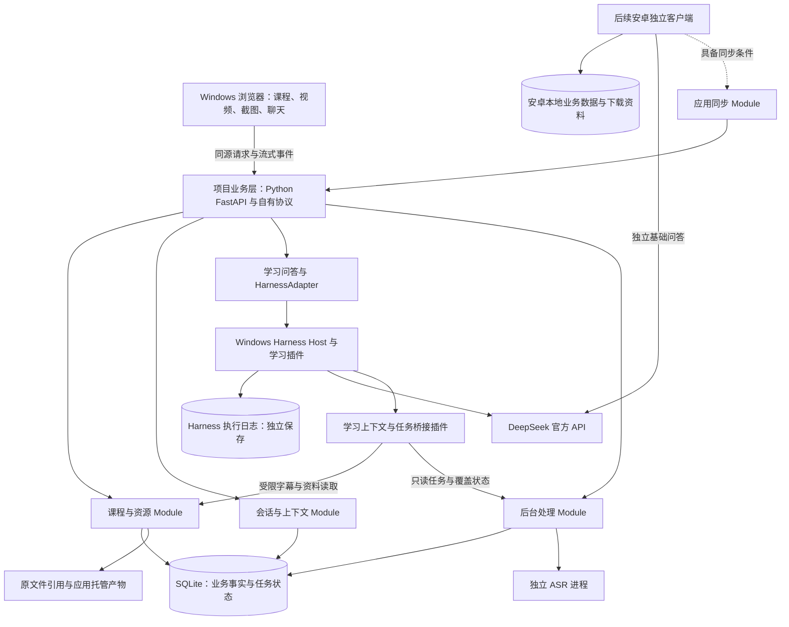

# AI 辅助学习项目技术选型方案

2026-10-21 当前授权：用户已明确恢复正式应用构建，本轮依次实施 P0-01～P0-04 并执行 V2-01～15；下文旧“暂缓构建／仅 V1”等阶段描述按日期保留历史，以本次决定及 [MVP 开发计划](../plans/MVP开发计划.md) 当前状态为准。V1 固定组合与窄适配须审核后迁入正式模块，不运行时依赖研究 probe；本轮不自动开展 MVP-A 完整视频功能、V3～V7、Office／ASR 全套、Android、同步或知识库用途设计。

本轮结果增补：正式 P0-01～04 与 V2 已验证并满足本轮 P0 退出；固定 Host、profile 与窄适配已迁入正式 `harness/` 和后台模块，实际工具／系统内容、正文停止后继续、业务持久化与 15 项故障矩阵分别留证。详见 [P0报告](../../research/reports/p0/P0-正式工程与执行数据基础验收报告-2026-10-21.md) 和 [V2报告](../../research/reports/v2/V2-P0持久化与故障窗口验证报告-2026-10-21.md)。当前止步于 P0，候选及后续完整功能仍按对应阶段验证。

> 2026-10-20审查后修订：按用户授权落实[立项审查](../../research/reports/inception/立项审查报告-2026-10-20.md)的工程约束、顺序与验收。先[V1隔离路线验证](../validation/V1-Harness最小路线执行方案.md)，再经明确恢复实施进入正式应用；V2—V7按对应阶段验。唯一工作包/状态在[MVP计划](../plans/MVP开发计划.md)，本轮只准备文档，不安装/实验/调用模型。候选与已确认需求仍分开。

> 阶段说明（2026-10-20）：用户已要求回到需求讨论阶段，正式构建暂缓。本文保留为既有技术方案与证据，实施安排待必要需求和首版范围确认后复核，不能据此自动启动 P0。既有已确认原则继续有效；Windows 核心与 Android 围绕连接 Windows 的具体分工，见 [需求讨论议程](../product/AI辅助学习项目需求总结.md#0-当前阶段与讨论议程)。

日期：2026-10-18；立项证据增补：2026-10-19（Asia/Shanghai）  
范围：Windows 个人首版，视频播放、用户主动截图与文字解题优先。  
状态：Windows Harness 执行层＋安卓独立客户端为当前路线。2026-10-19 已增加隔离空会话烟测与短段 ASR 运行证据；完整学习 profile、真实图文接入、接续和收益仍未验收。综合结论见《research/reports/inception/AI辅助学习项目立项调研报告.md》。

依据：《docs/product/AI辅助学习项目需求总结.md》《docs/product/AI辅助学习项目技术原则与分阶段范围.md》。

2026-10-20 议题 2 已收口：职责、用户上下文优先、按需检索、联网条件、自动处理等待及问答工具只读已确认；字幕 AI 纠错／校准取消，本地转写保留。以下对应方案已同步，具体接入、插件、预算与净收益仍待验证，不因议题收口恢复构建。完整需求见需求总结第 0.2 节。

本次修订覆盖此前「首版不依赖 Harness」的结论。当前 Harness 源码核查固定在提交 `687f282e8625c6b8d11ff58211a90524be2e4317`；固定研究提交不等于已安装或验证同版本发行制品。

2026-10-20 议题 9 确认知识库是必要功能，具体用法暂不讨论，后续议题 8 已确认纳入完整首版，具体用法与范围仍待细化。取消自动找题：不再安排按文件、章节、页码、题号或题意定位原题、题目目录、跨页原题自动组装和候选题选择；此前找题 2 秒目标取消。明确引用先定位限于用户已选取或提交的引用。保留按需补充相关字幕与课程资料；知识库其他具体范围和技术方案待后续复核，不自动恢复用途讨论或展开其他议题。

2026-10-20 议题 8 已收口，完整范围见需求总结第 0.18 节：先交付视频截图＋文字问答试用，再补齐包含 PDF／PPT／Word 阅读、多窗口、公式局部引用、本地字幕、知识库、整体迁移与离线查看及已确认运行管理的完整 Windows 首版。模型与思考强度可手动选择和更改，保留并复用 Harness 原有相关功能；基础学习统计展示后续，播放位置恢复保留。知识库具体用法仍暂缓讨论，技术组合和效果待验证；主要流程稳定可用后可先使用、继续优化速度，不以部分普通问题未达 10 秒单独阻止交付。本次只同步范围，须用户明确恢复实施后再复核工作包与技术实现。

### 本轮已确定的架构决定

1. Windows 以 DeepSeek Harness 和适用插件作为执行层主选，承接复杂 AI 任务；Python 转写和资料处理模块保留在 Windows，通过项目接口衔接。
2. 安卓具备独立基础学习与直接 DeepSeek 问答能力，不要求运行完整 Harness，也不要求将全部插件移植到安卓。
3. 电脑关机后，安卓继续使用已下载资料、主动截图、聊天与本地记录；Windows 专属任务等待电脑恢复。首阶段不要求此时手机与平板实时共同编辑提问。
4. 课程、资料、聊天、附件、进度与学习记录采用本项目自有结构；Harness 会话属于 Windows 执行记录，建立明确映射。
5. 插件逐项按能力、依赖、维护状态和 UI 耦合评估；后台工具、界面插件与 Windows 专属能力分开接入。
6. 议题 6 已确认 tsnet 内嵌连接与优先官方托管：Windows 管理打包的 Go 网络组件，Android 内置 Go 网络模块；双端接入与现用 VPN 并用仍需验证。应用同步模块负责消息、草稿、进度、离线合并和按需文件下载，不同步运行中的数据库文件，完整需求见需求总结第 0.8 节。
7. 首版仍只做 Windows，最高优先级为视频截图＋文字问答；按「用户提交内容 → 必要字幕 → 仍不足时知识库」补充信息，禁止 AI 自动补取视频画面。

## 1. 推荐结论

采用 **React＋TypeScript＋Vite 定制前端，项目自有业务层与 SQLite，Windows DeepSeek Harness 执行层和适用插件，Python/FastAPI 与 faster-whisper 转写处理模块**。

界面完全定制，播放器、截图编辑、公式渲染和媒体处理继续复用成熟实现。项目业务数据由本地业务层管理，Harness 的运行日志单独保存，GPU 处理使用独立 Python 进程。Harness 引入独立的 JavaScript 执行宿主；是否额外要求系统 Node 取决于选定发行方式，不能继续宣称 Node 只参与前端构建。

当前优先验证 **Harness Web Host 作为内部执行宿主＋项目业务层适配**：利用已有 prompt、实时 follow 和 cancel 能力，不要求显示官方 UI。**Python SDK＋执行桥接扩展**作为接入对照。二者都采用 Harness，具体接入以 P0 原型结果收敛，不因安卓后续独立运行而排除 Windows Harness。

直接调用 DeepSeek 的旧路径仅保留为受控性能诊断基线及后续安卓本端能力参考，不再是 Windows 主执行路线。

### 1.1 首版主选

| 部分 | 选择 | 对项目的价值 |
| --- | --- | --- |
| 前端 | React 19＋TypeScript＋Vite 8 | 可定制的本地单页应用，复用交互组件，输出静态资源 |
| 基础界面 | 已确认 shadcn/ui 按需取源码＋Tailwind CSS | 由项目统一维护组件与设计语言；具体版本、底座和兼容效果待验证 |
| 视频播放器 | `@videojs/react` 10，底层使用原生 HTML video | 复用控制、状态与皮肤能力；保留原生 video 作为兼容基线 |
| 截图与编辑 | Canvas 主动截图＋React Advanced Cropper | 用户触发取帧、缩放、移动、裁剪，只提交确认选区 |
| 聊天和公式 | 自定消息界面＋react-markdown＋remark-math＋rehype-katex / KaTeX | 保持消息和来源卡片格式可控，复用公式渲染 |
| 前端状态 | TanStack Query＋Zustand，职责分开 | 前者管理后台快照，后者管理输入、选区等临时状态 |
| 项目业务层 | Python 3.12 系列＋FastAPI＋Uvicorn | 管理自有业务数据、媒体路由与统一执行接口，保留现有 Python 处理方案 |
| Windows 执行层 | DeepSeek Harness＋学习 preset／适用插件 | 复用模型适配、工具执行、会话、附件与执行用量等能力 |
| 定制前端接入 | 优先验证内部 Web Host Peer 适配；SDK＋桥接作为对照 | 复用实时流与取消，同时保持自己的 UI 和业务协议 |
| Windows 模型接入 | Harness 官方 DeepSeek provider | 沿用其适配器与模型调用语义，不额外叠一条 Python SDK 主执行链 |
| 初测模型 | `deepseek-flash` | 官方当前支持图片输入，截图可直接参与解题 |
| 业务存储 | SQLite＋SQLAlchemy 2.x＋Alembic | 单机事务、数据迁移和可导出业务结构 |
| 视频与音频处理 | FFmpeg / ffprobe | 探测原文件、分段读取音频，避免全视频复制与全课 PCM 常驻 |
| 语音识别 | faster-whisper＋CTranslate2，独立 GPU worker | 本机转写；引擎、模型与任务调度各自明确 |
| 后台任务 | 应用持久任务表＋本地调度＋Python 处理进程，Harness 工具通过适配接入 | 长视频任务由一个调度方持有，避免 Harness 与应用重复排队 |
| 目录跟踪 | watchdog＋启动对账 | 跟踪原地引用的课程目录，增量处理变更 |
| 首轮关键词检索 | SQLite FTS5＋jieba 搜索分词＋数学词典 | 课程过滤及中文短词；不承担题号找题，范围待议题 9 复核 |
| 开发与锁定 | 项目独立 Python 环境、uv 锁文件、前端锁文件 | 验证后固定完整依赖组合，避免依赖当前全局环境 |

以上是工程选择，不是“该语言或框架天然更快”的性能结论。具体组件能力和版本依据见各专题研究文档。

## 2. 为什么采用这套组合

### 2.1 前端与后台各用合适的生态

React 负责视频、截图、聊天和公式交互；Python 业务层负责本地文件、业务存储、转写、解析与检索；Harness 承担 Windows 的模型执行与插件编排。当前需求没有首版 SSR、SEO 或云端全栈部署的要求，因此使用 Vite 产出静态界面即可。[React 单页应用指引](https://react.dev/learn/build-a-react-app-from-scratch)、[Vite 生产构建](https://vite.dev/guide/build)

本次不以「减少 JavaScript 执行进程」作为提前排除 Harness 的理由。先保留 Python 业务层和处理进程，通过一个 HarnessAdapter 封装内部 Peer 或 SDK 协议；是否再增加 TypeScript 中间层，只能由官方客户端复用收益与实际接入成本决定，不预设必须增加或绝对不能增加。

FastAPI 主进程处理网络和业务状态，重型计算隔离到 worker；仅将函数放入请求后的 `BackgroundTasks` 不能满足整课转写的持久恢复与优先级需求。[FastAPI 后台任务说明](https://fastapi.tiangolo.com/tutorial/background-tasks/)

### 2.2 成熟能力融入统一界面

2026-10-20，用户已确认前端与视觉方向，完整需求见需求总结第 0.20 节：采用 shadcn/ui＋Tailwind CSS，界面组件源码由项目掌握，播放器、文档渲染、公式及裁剪等底层复杂能力通过锁定版本的成熟开源库复用。基础 UI 与同类直接能力原则上各选一套；间接重复先核实际产物、体积和运行影响，有明确理由才例外，不强行覆盖不兼容版本。

整体采用温和放松的 DeepSeek 蓝白配色，正文和公式舒展，侧栏与工具栏紧凑；默认浅色，可手动切换深色。颜色、字号、间距、圆角与状态统一管理，专业组件控件按同一规则适配，既有大肥鱼聊天壁纸需求保留。具体色值、字体数值与观感仍待用实际中文、推导和题图验证，不把英文组件演示当作学习界面验收。

shadcn 的源码交付不表示没有底层依赖。当前研究源码存在 Base UI、Radix、React Aria 等不同底座，恢复实施时须选定一套主要底座并逐组件核查依赖，不复制官方多方案演示站的全部依赖。此处不锁定某个底座或源码快照为交付版本；详见 [前端与舒适视觉调研](../../research/topics/流行前端方案与舒适视觉选型调研-2026-10-20.md)。本次仅确认方案方向，不开始安装或构建。

2026-10-20 已按用户要求整理[完整前端方案](前端方案.md)，覆盖页面、统一视觉、成熟库复用、状态与接口、输入权限、Codex 辅助流程及分期验收。工程建议优先验证当前 shadcn 默认的 Base UI，固定前仍须实际兼容检查；具体版本、尺寸和样板评审方式不自动成为新增用户决定，项目继续暂缓构建。

Video.js 10 提供可组合的 React 播放能力和可修改皮肤，原生 Video 保留 video 元素接口，便于主动截图。现有样本是 MP4/H.264/AAC，首轮直接播放，不默认整课转码或增加流媒体封装。[Video.js React](https://videojs.org/docs/guides/installation/react)

React Advanced Cropper 功能贴合缩放、移动和裁剪，先做 React 19 下的实际编辑与坐标测试。如果该组合不能通过，替代为 React Image Crop 配合有限缩放视图。播放器和编辑器的业务产物只保存来源、时间、源图坐标和图片引用，不把第三方内部状态变成长期数据格式。[Cropper 操作接口](https://advanced-cropper.github.io/react-advanced-cropper/docs/components/Cropper/)

### 2.3 Harness 成为 Windows 执行层主选

复用重点为官方模型适配、工具注册与 guard、agent loop、执行会话、附件、用量与适用的后台工具插件。应用保有课程、题目、截图、字幕、持久聊天和任务结构，通过执行映射衔接。首版学习预设不默认使用多代理，也不照搬编码代理的 shell、任意图片读取和软件工程 persona。[固定提交架构](https://github.com/deepseek-ai/deepseek-harness/blob/687f282e8625c6b8d11ff58211a90524be2e4317/docs/architecture.md)

插件必须按实际能力分组：模型／工具／执行插件优先复用；Office 转换等后台能力逐项验证；官方 UI 插件评估宿主耦合；长视频 GPU 转写继续使用 Python。存在录音 ASR 插件不等于已经具备网课字幕流水线，存在会话搜索也不等于已经具备课程资料 RAG。

复用可以减少部分开发工作，也会增加进程、适配和版本维护成本。目前没有项目 A/B 数据，不能承诺净节省工期、内存或 token 的比例。具体清单及验证见第 12～14 节。

## 3. 运行结构与模块接口



按 **Module / Interface** 组织：调用方只需要理解小 Interface，复杂性集中在 Implementation 内部。具体示例如下，属于接口草案而非代码或已建服务：

| Module | 调用方需要知道的 Interface | 内部处理的复杂性 |
| --- | --- | --- |
| 课程与资源 | 导入位置、查询资料、定位来源、刷新课程 | Windows 路径、目录通知、版本、原地引用与缓存 |
| 媒体与截图 | 打开资料、跳转时间、用户主动 capture、提交选区 | 第三方播放器、原图像素坐标、编辑状态与附件导出 |
| 会话与上下文 | 追加消息、读取历史、组装当前请求上下文 | 完整历史保存、旧内容摘要、相关消息和图片取回 |
| 学习问答与执行适配 | 提交问题、订阅答案事件、取消生成 | Harness 会话映射、内部协议、图片输入、字幕与知识库补充、usage 与引用 |
| 后台处理 | 排队、查看状态、暂停/恢复、退出 | 去重、优先级、租约、子进程、片段检查点和旧结果失效 |

SDK 对象、数据库连接、Windows 绝对路径和播放器内部 store 不跨模块任意传递。先建立实际需要的接口，不建设通用插件或分布式工作流平台。

其中 `submit/follow/cancel` 是本项目拟定的 Interface，不代表官方 SDK 已具有同名能力。业务聊天 ID、请求 ID 与 Harness 会话/事件映射独立保存；不会把 Harness 的全部内部事件直接转成客户端的长期业务协议。

## 4. 核心路径：截图与文字优先

### 4.1 视频与主动截图

1. 用户选择原视频或课程目录，后台登记资源 ID 与原文件位置。
2. 浏览器通过 `/media/{asset_id}` 同源 Range 路径播放，不读取完整视频后再转换为 Blob/base64。
3. 用户点击截图或应用内快捷键，自动暂停视频，记录当前时间，按 `videoWidth/videoHeight` 取得这一帧。
4. 用户缩放、移动、裁剪，确认选区；原图与裁剪关系本地保留。
5. 选区进入聊天输入区，用户补充文字并发送。
6. 模型只接收用户提交的图片；不会自动取得完整原图、附近帧或其他画面。
7. 用户通常等待并看完回答后，点击关闭聊天框按钮，收起问答区、恢复视频全屏并继续播放；当前对话及历史保留。边播放边问答的已有能力继续保留。

议题 4 已确认完整题目的输出顺序为简短具体思路与理由、连续完整解答，关键步骤解释、常规运算合并；鼠标操作本身便捷，快捷键进一步提速。日常大多数问题以 10 秒内出现有用解题内容为目标，复杂题和资料查询分别评估；这不是已验证性能或模型参数决定，详见《需求总结》第 0.3 节。

Range 的具体行为依赖锁定的后台组合，需验证实际浏览器播放和 seek。[HTTP Range](https://developer.mozilla.org/en-US/docs/Web/HTTP/Guides/Range_requests)

### 4.2 原地引用的文件选择

浏览器普通文件输入不会提供真实 Windows 绝对路径，所以不能依靠 `input[type=file].value` 完成原地引用。[MDN 文件输入](https://developer.mozilla.org/en-US/docs/Web/HTML/Reference/Elements/input/file)

采用本地后台支持的 Windows 文件/目录选择辅助进程，用户主动选择后只登记路径；调试时允许粘贴路径。推荐封装系统现代 `IFileOpenDialog`，复用 Windows 文件选择界面；现有 pywin32 的文件/目录选择能力可作为原型后备。当前 Python 没有 tkinter，pywin32 也没有直接导出 `IFileDialog`，具体绑定及辅助程序在接入时验证，不虚构现成支持。[Microsoft Common Item Dialog](https://learn.microsoft.com/en-us/windows/win32/shell/common-file-dialog)

外部截图粘贴仍直接读取图片附件，不涉及视频原路径选择。

### 4.3 模型请求流程

```text
用户文字／图片／引用＋相关已提交历史与修正＋可见来源定位信息
    ├─ 用户已选取或提交的资料引用：程序解析来源位置，再交给模型回答
    └─ 其余：主回答模型直接解答，或按信息缺口请求受限工具
                    ├─ 讲解上下文缺失：相关字幕，必要时当前课程资料
                    ├─ 明确外部信息需求：允许的网页搜索／读取
                    └─ 关键条件确实缺失：说明缺口，请用户补充
```

目标是信息充分的路径不增加无必要的模型轮次。一次 Harness run 不等于一次模型请求；工具、摘要、重试等都会影响实际次数，必须以执行链与 usage 实测。仅提供未提交题目的题号时，请用户选取或补充题目，不自动寻找原题。

不默认增加独立 AI 分类请求。默认来源为当前课程，跨课程须用户明确指定；题难、推导出错、字幕未就绪或课程检索未命中不单独构成联网理由。来源定位信息可见不等于正文预读取。

由项目策略和 Harness 学习插件限制阶段、工具参数、结果量、次数和等待。首版问答工具只读；课程整理、改名、移动等由界面发起的业务功能负责，聊天和附件仍正常保存。自动补图不属于可调用工具，不能只依赖提示词禁止。图形或关键条件确实缺失时，请用户补充。

正常检索自动完成，显示简短状态、回答来源及按需详情；单次未命中可在允许范围内有限调整，不逐次确认。真正失败或缺少必要信息时才提示，用户随时可停止。超时、有限重试和嵌套搜索预算需程序执行并验证，不将首次有用内容目标当作所有检索的硬截止；未知生成先对账。主模型调用工具后仍有读取与续答开销，分别评估误检索、漏检索和等待。[按需检索研究](../../research/topics/按需上下文检索触发与等待控制调研-2026-10-20.md)

Windows 首版通过 Harness 官方 DeepSeek provider 接入，保留并复用 Harness 原有相关功能，允许用户手动选择、更改模型与思考强度；`deepseek-flash` 是既有图文验证候选，不是锁死的唯一选择。实际可用模型及各自输入能力须按固定版本适配验证。固定源码的官方适配器使用 Anthropic-compatible Messages，不能把旧 Python Chat Completions 参数原样套入。图片输入仍只包含用户已提交内容；安卓后续直接调用官方 API，协议通过本端适配器封装。[Harness DeepSeek 适配器](https://github.com/deepseek-ai/deepseek-harness/blob/687f282e8625c6b8d11ff58211a90524be2e4317/packages/llm/llm-deepseek/README.md)、[DeepSeek Vision](https://api-docs.deepseek.com/guides/vision/)

### 4.4 流式回复与重复请求

- 视频状态与聊天流分别订阅，回答增量按小批次刷新，避免每个 token 重渲染播放器和全部公式。
- 优先验证 Web Host 的实时 follow/cancel 与项目事件投影；现有 SDK notification 只有结算事件等通知，不等于实时 token 通道，也没有中途取消方法。不能靠快速回放已完成文本冒充实时输出。
- 持久消息与临时流状态分开；按批保存已生成文本，不把每个 token 长期存成一条行为事件。
- 用应用请求 ID、执行 generation、Harness 接收凭据与事件序号建立映射，防止重复点击、重连和跨端合并导致重复执行。
- 同一业务对话的模型执行串行化，不把 SDK 的最终文本字段视为天然对应某一条输入；使用请求、turn、step 和绑定版本核对。
- 不能仅限制重试次数。固定Harness默认normal会对TIMEOUT/TRANSPORT等重跑，须按是否已确认未受理分类；未知执行先对账，无法确认保持unknown。隔离初测可明确maxRetries=0；前端/业务/worker不再叠模型重发，取消按实际终态/对账确认。
- 已开始生成后断流，先恢复已保存状态；不能把“未收到最终回复”当成“服务方未处理”，无声重发可能重复计费。
- 保存可得provider raw及原样Harness usage、字段存在性、来源和结算身份；上游默认0不能证明原字段存在。缺失/断流/取消对应计量未知，累计值不逐块相加，已含reasoning的输出不重复加。
- 实际出站派发统一统计attempt，含摘要/标题/工具续答/provider内部替换；实验总预算guard不只数prompt/UI点击。无法可靠计数不启动真实实验；不因此新增日常固定消费上限。

### 4.5 模型与上下文用量

2026-10-20 议题 16 已确认：模型与思考强度由用户选择，不为省钱自动切换模型或降低思考。以下配置比较仅用于确定后续默认值，实际效果待测；暂不设固定费用上限，保留真实用量。完整结论见需求总结第 0.11 节。

在后续授权的受控测试中，可用当前 route 的 `off` 与 `low` 对照速度和效果，不直接复制 SDK 示例中的 max 强度或巨大输出上限；这些是测试候选，不是自动降级规则。实际使用由用户手动选择和更改，保留 Harness 原有相关功能；默认值待实测复核，不能覆盖用户选择，也不预先声称关闭思考没有质量代价。[Harness route 配置](https://github.com/deepseek-ai/deepseek-harness/blob/687f282e8625c6b8d11ff58211a90524be2e4317/packages/llm/llm-deepseek/README.md)

界面完整保留历史；模型上下文保留当前题目中用户已确认提交的图片/裁剪图、条件和必要推导，旧内容按阈值摘要或取回。本地保留的完整原帧只用于重新编辑，不能因为取回旧上下文而自动发给模型。摘要不每次重新生成，课程大段资料不固定放入每次请求。

业务历史与可见范围由项目管理；Harness 可在授权的执行上下文中使用压缩插件。应用快照与 Harness 摘要建立版本和来源关系，避免对同一历史反复做两层付费摘要。安卓新消息通过业务同步先入库，再决定恢复或重建执行 generation，不能只调用 resume 就声称上下文已接续。

默认compaction按token尾部选择、image-offload对特定图片occurrence作持久占位，不能据此保证当前题图/条件/更正。业务侧确定性保留必要确认图与修订并核实际请求；压缩和旧图取回仍不得发送完整原帧。原裁剪→Harness规范化→请求图三层分别验，小字/手写清晰度与“上传成功”分开。

前缀缓存可能降低费用与延迟，不保证命中，也不等于 `prompt_tokens` 消失。复用远端图片 ID 可减少上传，不等于免除图片 token。[DeepSeek 缓存](https://api-docs.deepseek.com/guides/kv_cache/)

模型别名可能由服务方升级。固定 SDK 和应用配置后，仍需记录实际响应的模型标识/指纹与基线，不能声称冻结云端模型权重。

## 5. 本地转写与后台生命周期

### 5.1 进程分工

- 项目业务后台管理 HTTP、自有会话、任务状态和业务数据写入；Harness Host 管理插件、agent 与执行日志。
- 独立 ASR worker 在转写期间加载一个模型，以一个 GPU 重任务为起点；转写完成或长时间暂停后释放模型占用的内存和显存，下次按需重新加载。释放时机、回收效果和加载等待待验证，持久化产物与任务进度保留。
- worker 通过进度/结果消息回报，主后台统一提交业务状态，避免各处理进程自行维护数据库事务。
- 长视频处理任务由应用队列持有，问答工具只读任务与覆盖状态，不提交、取消或重建整课任务；导入、暂停与退出通过软件业务功能处理。当前问题需要未生成字幕时，由业务调度按需安排必要片段，保持问答工具只读；具体接入待验证。
- 取消字幕 AI 错字纠正／校准，不再向 Harness 提交后台纠错任务；前台解题优先，文档 GPU 解析以后也共用重任务配额。

### 5.2 转写首测配置

引擎采用 faster-whisper / CTranslate2，复用集成的 Silero VAD。首测多语言 `turbo`，中文转写、单 worker、小批量，`int8_float16` 与 `float16` 对照；`large-v3` 用于比较术语效果。模型和计算类型尚未最终固定。[faster-whisper](https://github.com/SYSTRAN/faster-whisper)

按有限时段提取单声道音频，再交给模型，避免将整节 3 小时课程一次性解码到内存。可从 30～60 秒片段、停顿切分和少量重叠开始测试；重叠去重且保留原视频绝对时间。数学术语词表作为短提示，不能保证识别正确。

转写片段可用后立即开放，不增加模型校准请求，不显示逐句存疑标记或要求逐段审核。保留原始文字、时间轴及手动修订；按片段 ID、来源修订提交产物，旧结果不能覆盖用户修改。字幕可辅助定位讲解，关键数学符号与题图冲突时明确说明，不静默替换题目条件。

### 5.3 调度、暂停与恢复

2026-10-20 议题 16 已收口：电池供电时照常转写，不因拔掉电源自动暂停。后台转写默认偏向降低发热和风扇噪声、允许耗时更长，提供“加速处理”选项；两种模式和电池供电均须服从前台播放、截图和当前问答优先。具体资源预算、档位及实际效果待验证，释放模型不得自动恢复用户暂停的批量队列，详见需求总结第 0.11 节。

任务记录来源修订、参数版本、时间范围、优先级、状态、检查点及产物引用，以去重键保证已提交结果不重复入库。

优先顺序：当前前台操作 → 当前问题依赖的字幕片段 → 当前观看片段 → 整课剩余处理。

2026-10-20 议题 13 已收口：导入后对缺少可用字幕的视频自动安排整课本地转写，当前观看的视频优先，其余后台排队，支持按课程或视频暂停。批量转写暂停后，当前问题仍可自动触发必要小段字幕的临时处理；业务调度区分按需片段与批量队列，处理结束不自动恢复整课队列，用户可停止当前处理。上述为已确认需求，具体状态与调度接入留待验证，不新增问答模型修改字幕或整课任务的工具权限。

后台转写正常完成只更新进度，不弹窗、不发声音；文件缺失、持续失败等需要用户介入的问题才主动提醒。完整结论见需求总结第 0.9 节；本次收口不表示恢复构建或确定完整首版范围。

优先级影响下一个片段，不代表能立即抢占正在执行的 GPU 推理。正常暂停在当前片段提交后生效；强制退出后可以重做未提交片段，已完成片段继续复用。

关闭网页后业务后台、Harness 和已运行的处理任务继续，提供暂停与明确退出入口。启动器管理各进程、健康检查和清理；Harness 退出不应无声删除业务消息。重启分别恢复应用任务与可恢复的执行绑定，不能把“恢复日志”当成恢复所有外部进程。

2026-10-20 议题 14 已收口（完整结论见需求总结的议题 14 收口记录）：第一版安装或解压后可双击统一入口，启动后台并打开浏览器学习页面，用户无需终端或开发环境；内部组件由软件管理。默认手动启动，可主动开启开机启动。有任务时退出先提示，确认后保存已有内容与进度、尽快停止并退出，不等待全部完成；异常时有限自动恢复，失败或需用户操作时才提醒。AI／转写组件故障只影响对应功能，其余学习功能继续可用，提示影响并提供重试入口。默认遵从 Windows 睡眠设置，可主动开启保持唤醒，睡眠前尽可能保存进度、唤醒后恢复。任何恢复都不能绕过未知执行先对账、不自动重发的约束；具体打包、停止、故障隔离与恢复效果未验收，相关运行管理已按议题 8 纳入完整首版，本次不恢复构建。

单机首版采用持久任务表即可。Celery 官方不支持 Windows，当前也没有必要为本地任务引入 Redis 等独立设施。[Celery 平台说明](https://docs.celeryq.dev/en/stable/faq.html#does-celery-support-windows)

## 6. 存储、原地引用与检索

### 6.1 数据分层

| 数据 | 位置与规则 |
| --- | --- |
| 原视频、讲义、课件 | 保留原路径，资源 ID 与设备本地路径分开 |
| 截图、字幕、解析产物 | 应用数据目录，按内容及来源修订复用 |
| 课程、会话、任务、学习事实 | SQLite 业务表 |
| Harness 执行会话、内部附件与日志 | 独立 Harness home，业务层记录映射与必要结果；不直接作为同步协议 |
| 全文与向量索引 | 可按源资料重建，不作为唯一业务事实 |
| 播放进度、计时和行为明细 | 结构化数据，按既定原则汇总，不全部加入知识库 |

使用稳定 UUID 作为业务身份，时间和排序显式保存。原始视频不存数据库 BLOB；Windows 路径不是跨端资源 ID。课程目录变化通过 watchdog 防抖、文件稳定检测与启动对账进入增量处理。

采用 SQLAlchemy 2.x 管理持久模型，Alembic 管理 schema 变更。数据库事务保持短小，模型请求和 GPU 运算不持有写事务。[SQLAlchemy SQLite](https://docs.sqlalchemy.org/en/20/dialects/sqlite.html)、[Alembic](https://alembic.sqlalchemy.org/en/latest/)

### 6.2 SQLite 运行库条件

推荐本机 WAL，实施前确认实际运行库带官方 WAL-reset 修复：3.51.3 及以后，或官方明确的回补版本。本机 Python 当前带 3.45.3，不能直接当成已验证的 WAL 基线。[SQLite 官方说明](https://sqlite.org/wal.html#the_wal_reset_bug)

单独创建虚拟环境不会自动升级解释器自带 SQLite。需要选择满足条件的项目 Python 运行库，并实际查询 `sqlite3.sqlite_version`。如原型阶段尚未取得合适运行库，可先使用普通 journal 模式做功能验证，再切换经过验证的 WAL；不修改用户全局 Python DLL。

### 6.3 知识库检索顺序

1. 限定课程与来源版本，解析用户已提交引用的文件、页码或区域；不按题号自动找题。
2. jieba 搜索模式＋数学词典预分词，再进入 FTS5 关键词召回。
3. 是否需要本地语义召回及与关键词结果融合，按议题 9 的剩余资料检索需求复核，不再以找题为实施依据。
4. 按来源取得与问题相关的资料片段及必要图形和引用位置，仅发送必要结果，不自动组装原题。

默认 FTS5 不会自动正确切分中文，trigram 的短查询也会漏掉两字词。本次已用内存样本验证这一点。[FTS5 分词器](https://sqlite.org/fts5.html#tokenizers)、[jieba](https://github.com/fxsjy/jieba)

既有语义分支候选为 `BAAI/bge-small-zh-v1.5`，CPU 运行；向量存储候选 sqlite-vec。找题取消后，这些仅作为候选保留，不代表仍须实施，是否需要由剩余知识库需求决定。如采用，其版本需固定、索引可重建，Windows 扩展加载、检索效果与资源占用须测试。[模型卡](https://huggingface.co/BAAI/bge-small-zh-v1.5)、[sqlite-vec](https://github.com/asg017/sqlite-vec)

几十 GB 原视频不等于同样规模的待嵌入文本。只处理有效字幕和资料文本单元，不嵌入视频字节、每帧图片或全部行为事件。

### 6.4 资料解析与资产迁移

PDF 阅读定位采用 PDF.js，后端原生文本与页面渲染采用 pypdfium2；扫描、结构化版面和公式解析以 Docling 为候选。Office 缓存预览与旧格式转换优先验证 Harness 的 `dsh-office-to-pdf`／LibreOffice Kit 复用，独立 LibreOffice 适配作为兼容后备，避免同时重复建设转换流水线。按原页位置保存来源，不用模型生成文本替代原文。[PDF.js](https://mozilla.github.io/pdf.js/)、[pypdfium2](https://github.com/pypdfium2-team/pypdfium2)、[Docling](https://github.com/docling-project/docling)、[Harness Office provider](https://github.com/deepseek-ai/deepseek-harness/blob/687f282e8625c6b8d11ff58211a90524be2e4317/packages/document/office-to-pdf/README.md)

这些依赖在对应功能阶段按需安装。中文扫描公式效果要验证；PDFium 需串行或受控进程使用，Docling 模型与转换程序有各自许可及运行依赖，详见专题报告。

议题 15 已收口，需求以需求总结第 0.15 节为准：不建设历史备份功能，支持用户主动整体导出／导入更换设备。默认导出全部软件业务数据与附件，包括课程组织、聊天、截图、字幕及手动修订、进度、学习记录和来源关联；用户可选包含原始视频和课件。未包含原件时支持重新定位，保留来源版本。导入只做整套迁移恢复，暂不合并已有数据；目标已有数据时明确提示，不自动覆盖。

导出包同时提供可用浏览器离线查看的聊天记录，保留消息顺序、公式、截图及来源名称，不要求安装本软件。软件数据目录提供默认位置、用户自选及通过软件整体迁移能力，设置中显示路径与占用；不改变原件原地引用的规则。有版本的 JSON 清单作为格式候选保留，最终格式、完整性检查、离线显示与目录迁移的实现均待验证。

导出／导入须保持业务数据和附件一致，不把运行中的数据库文件简单复制当成完整方案。既有 schema 迁移前可恢复与资产保护要求继续有效，不据此新增历史备份产品功能。本项未实现或验收，具体能力已按议题 8 纳入完整首版，不表示恢复构建。

## 7. 后续安卓与同步演进

首版只在 Windows 交付。后续采用「Windows Harness 执行端＋安卓独立客户端」：安卓本端不要求完整 Harness，基础学习和直连模型可以脱离电脑，Windows 专属插件能力通过统一任务接口使用。

议题 6 已确认的网络组合为：Windows 随学习软件打包、隐藏启动并管理 Go 网络组件，经 tsnet 转接自有业务接口；Android 在同一 APK 内置 Go 网络模块，可评估自有 Go 桥经 gomobile 生成 AAR，用户无需另装 Tailscale 客户端。控制与中继优先使用官方托管，处理首次授权、设备绑定、持久身份及重连，现用 VPN／代理并用须实际验收。Go 桥形态、平台适配与协议边界尚未实现，不能把官方 Android 客户端内部 AAR 或未合入补丁当作开箱可用 SDK。[tsnet 固定版本及平台证据](../../research/topics/Tailscale-tsnet内嵌能力调研-2026-10-20.md)

后续安卓可评估复用 Web 界面，但文件、存储、模型网络和同步接入保留平台 Interface。纯 PWA 仅可验证适用的界面部分，普通浏览器不会自动获得进程内 tsnet 网络；完整内嵌路线需要原生模块及受限请求通道。可评估 Capacitor 等原生适配，尚未锁定客户端框架。自有本地 HTTP 桥或兼容的 SOCKS5 接入留作工程方案，视频范围读取、拖动、取消与真实回答流分别验证；不要求重写现有 Windows 后台或 Harness。[浏览器存储限制](https://developer.mozilla.org/en-US/docs/Web/API/Storage_API/Storage_quotas_and_eviction_criteria)、[Capacitor](https://capacitorjs.com/docs/)

多端实施时：

- tsnet 负责在线设备连通，应用负责设备业务授权、记录与文件同步；内部 Harness Peer、LocalAPI 管理权限和任意文件路径不开放为远端业务入口。
- 电脑在线支持实时协作；电脑离线时各端独立运行，之后合并。
- 议题 12 已确认多端共享同一对话及实时共享未发送草稿（文字、已确认加入的截图和引用），首次多端交付须一起提供；草稿同步不触发模型调用。保留并复用 Harness 原有对话功能，项目负责补齐同步能力，输入框接入、附件传输、延迟及恢复仍待验证，不能认定 Harness 原生已完整支持。完整需求见需求总结第 0.7 节，不改变 Windows 首版范围或电脑离线边界。
- 电脑关机时，安卓可看已下载资料、主动截图、直接 DeepSeek 问答并本地保存；依赖 Windows 的转写、工具或资料处理任务保留待执行状态。
- 首阶段电脑离线时，不要求手机和平板实时共同编辑提问。
- 新消息和附件追加合并，同一字段按较新修改自动决定，不弹窗选择。
- 依据已观察的因果关系与逻辑版本排序；离线并发修改不能保证判断现实先后，按稳定规则自动取胜，不按上传先后覆盖。
- 每份资料进度由 Windows 统一管理，设备打开时读取，使用中定期更新并在暂停／切换／退出时补存；以实际操作及版本规则排新旧，防止迟到旧状态覆盖和错误取最大页码／时间点。Windows 不可达时保留本地状态，完整离线能力仍待议题 3。
- 进入课程只展示目录，不自动打开上次资料；用过的资料按最近成功打开时间倒序，未打开的排后按文件名自然排序。最近使用由 Windows 管理，下载／同步不计使用；进入课程或主动刷新时重排。视频打开恢复位置并自动播放，不提供同视频多端播放联动；共享对话与草稿不受影响。
- Android 视频按当前位置从 Windows 读取并边播边缓存，拖动优先取目标范围，命中同版本缓存可本地复用；用户主动完整下载视频或课程。临时缓存受容量限制可回收，主动离线保存不按临时缓存自动删除，均保留来源版本。
- 完整下载默认等待 Wi-Fi，可单次选择移动流量；日常点播自动播放。带宽不足时允许 Windows 按需转码并自动降码率，保留手动原画；板书与公式可读性优先，转码受前台播放／问答优先级约束。缓存容量、预读、转码档位及资源预算待验证，不向 AI 增加未确认的视频输入。
- 同步业务实体与变更，不直接同步运行中的 SQLite 文件。
- 安卓新增已完成问答先合并到业务聊天；随后通过执行快照和绑定版本接续 Harness，不重放成新的待执行提问。
- Windows 工具插件不必移植到安卓；UI 插件按宿主依赖单独评估，不能因能在浏览器运行就认定可直接独立移植。

首版不提前安装移动端数据库、CRDT 框架或同步服务器。番茄钟、伴侣和复盘由对应 Module 在后续接入，普通动画、计时与统计由程序执行。

第 6 项讨论已收口，技术兼容尚未验收。后续恢复实施并进入多端阶段后，先固定 tsnet／Go／移动绑定与 NDK 组合，验证 Android 普通 App 启动、授权与重开恢复，再验证 Windows 组件生命周期、真实异地与 VPN 并用、网络切换、范围读取／缓存版本／转码和进度去旧。此处不提前安装依赖、不扩大当前 Windows 首版；首次多端共享对话与实时草稿仍按议题 12 一起交付。

## 8. 版本和运行环境策略

| 项目 | 本轮证据或候选 | 实施条件 |
| --- | --- | --- |
| Harness 执行运行时 | 研究提交 `687f282e...`，源码包多为 `0.2.1-rc.2` | 主选进入 P0；需核发行制品、插件依赖闭包和 Windows 启动，不把 preview 称为已验证稳定组合 |
| JavaScript / Node | 本机 Node 24.14.0 | Harness 需要 JS 执行宿主；是否另装系统 Node 由制品决定，Python SDK 的 bundled runtime 路线不要求系统 Node |
| React / React DOM | npm 核对 19.3.1 | 成对固定并完成编辑、视频和流式交互检查 |
| Vite / React 插件 | 核对 8.3.4 / 6.1.2 | 在 Node 24 下构建并锁定 |
| TypeScript | 当前正式发布版 7.0.2 作为首测候选，兼容后备 5.9.3 | 完整类型检查和依赖构建通过后固定，不仅检查 peer 声明 |
| Video.js React | 核对 10.1.0 | 真实视频播放、跳转、截图和字幕轨道验收 |
| React Advanced Cropper | npm 0.20.1 | React 19 下编辑、窗口缩放及导出坐标检查 |
| Python | 项目隔离的 3.12 系列 | 不直接沿用全局环境，核对 SQLite 与 GPU 动态库 |
| FastAPI / Starlette / Uvicorn | FastAPI 0.145.0 为核对时发布信息 | 由依赖解析选兼容组合，重测 Range 与长连接后固定 |
| faster-whisper / CTranslate2 | 历史环境1.2.1 / 4.8.0候选 | 有2026-10-19局部DLL配置下60秒推理记录；正式隔离依赖、时间轴/数学/并行仍需V6 |
| SQLite | 需带 WAL-reset 修复的实际运行库 | 当前 3.45.3 不是正式 WAL 基线 |

版本号只表示本轮核对结果或兼容候选。尚未生成并验证项目的完整锁文件，因此没有把这张表称为已验收安装清单。uv 支持锁定解析结果及显式升级。[uv 锁定说明](https://docs.astral.sh/uv/concepts/projects/sync/)

版本日期补充：2026-10-20审查复核的npm dsh latest/next均为0.2.1-rc.2，SDK latest仍0.0.1-rc.1、next为0.2.1-rc.2；旧报告10-19标签保留为历史，不能当今日安装指令。所有采用版本仍显式锁定，标签相同也不证明依赖/学习组合兼容。本轮未安装或新解析锁文件。

DeepSeek 凭据由 Windows 本地后台管理，不写入前端构建产物；长期保存采用系统凭据能力的适配实现，具体库随运行环境验证。首版后台绑定本机地址，资料访问依据登记的资源 ID，后续跨端通过明确的连接入口扩展。

应用将必要凭据通过受控进程环境或 Harness 支持的凭据引用委派给执行层；内部 Host 的 Peer token/Cookie 不发给浏览器或同步到安卓。实际凭据存储和泄露到诊断日志的防护属于接入验证，不把“有 API Key 参数”视为已完成集成。

本地浏览器业务API仍需自己的会话/能力与Host/Origin/WS校验、必要CSRF防护；loopback/同源/CORS不等于完整授权。资源按已登记ID/版本读取，不能成为任意路径/进程控制代理；不新增用户注册登录。

## 9. 2026-10-18 检查记录与未完成事项

### 9.1 当时已完成的局部检查

| 检查 | 结果 | 证明范围 |
| --- | --- | --- |
| 用户视频元数据 | MP4，510,261,596 字节，约 3 小时 25 分钟，960×720 | 本地容器与流信息 |
| 补充编码信息 | H.264 High / avc1，yuv420p，level 40 | 编码信息，不代替浏览器播放 |
| Range 头部 1024 字节 | 206，Content-Range 和长度正确 | 全局 Starlette FileResponse 小范围 ASGI 响应 |
| Range 尾部 1024 字节 | 206，尾部范围正确 | 小范围读取，不是完整播放 |
| HEAD / 越界 Range | 200 且空 body / 416 | 基本媒体响应规则 |
| CTranslate2 | 可导入，枚举 1 个 CUDA 设备，支持 float16 / int8_float16 | 没有模型推理 |
| cuDNN DLL | 现有 wheel 中 cuDNN 9 DLL 可加载 | 完整模型依赖链仍待测 |
| 中文 FTS 内存样本 | 默认 unicode61 漏中文词；trigram 漏两字词；预分词命中 | 只证明分词设计需要调整 |
| DeepSeek 无凭据 OPTIONS | 当前测试 origin 的预检响应允许相应请求头 | 没有带鉴权 POST，不保证安卓实际调用 |
| 文件选择依赖 | 当前 Python 无 tkinter | 需要明确配置原生文件选择实现 |

此前 Range、GPU 加载与中文 FTS 结果只验证相应模块，不证明 Harness 路线、插件、接续或 token 收益已经通过。本轮调整仅进行了固定源码与文档核查，没有启动 Harness 原型、安装插件、抽取视频画面或发送付费请求。Range 使用现有全局 Starlette 1.2.1；最终隔离组合必须重测。

上段记述 2026-10-18 的架构修订状态，不是对后续调查的否定。2026-10-19 新增的实际运行证据见第 15 节和立项调研报告。

### 9.2 分阶段验证门槛

| 时点 | 方案与必要证据 |
| --- | --- |
| 正式应用前 | V1：Web Host固定学习组合、确认图片、真流/活动停止后追问、guard/外发、未知不重发/usage存在性。SDK桥接在有受阻证据时对照，不并建两套完整适配 |
| P0持久化/试用前 | V2：DB/附件/执行日志的发布故障、幂等/epoch/unknown、Windows恢复与必要外部已完成历史样例；不做同步平台 |
| 视频试用 | V3：实际播放/裁剪/图文/停止/保存/数学与操作收益，首次有用内容/完整答/完整流程分记；受控试用不强加完整打包 |
| 完整首版专业能力前 | V4公式局部选择；V5文字/扫描PDF及实际Office格式/保真；依赖均在对应阶段固定 |
| 字幕交付前 | V6：少量音频/时间轴/真值先行，再队列/手改/前台并行/资源释放，最后延长运行，不先整课 |
| 完整首版交付前 | V7：导出导入/离线查看/目录迁移与干净Windows运行/故障/睡眠/设置，分别验收；知识库另待实际用途收口后验C-03 |

各方案在[验证入口](../validation/README.md)，当前仅编写与准备，均未执行。没有前置/授权时明确未覆盖，不把后续全部问题变成立项或试用门槛。

## 10. 当前实施顺序与权威入口

| 顺序 | 交付闭环 | 核心验收 |
| --- | --- | --- |
| P0-00/V1 | 隔离路线判定 | 实际图片/增量/活动停止/范围/未知与计量，所需维护可界定 |
| P0-01—04 | 明确恢复实施后建立骨架、学习组合/适配及业务持久化 | 复用V1证据但重新产品化；V2故障与接续样例；旧P0-05并入 |
| MVP-A | 原地视频→截图编辑→Harness问答→保存/继续追问 | V3数学/操作/等待/保存，充分图文不等字幕/知识库 |
| B/C/D完整首版 | 字幕/手改/队列；PDF/Office/知识库；迁移/离线/位置；局部公式/多窗；运行/设置 | 各自V4—7与C-03任务证据，按依赖并行，完整首版不被试用替代 |
| 后续 | Android/tsnet/同步、英语、平台、统计、番茄钟/计划/伴侣/复盘 | 对应阶段再验，首次多端共享对话与实时草稿一起交付，离线边界待议题3 |

详细编号、依赖、完成判据与唯一状态以[MVP计划](../plans/MVP开发计划.md)为准；本表只描述顺序，不另设完成状态。旧D/E后续编号已被主计划的完整首版D系列取代，不能按旧字母混读；后续能力统一按后续阶段理解，已确认范围不变。

## 11. 专题研究记录

- 《research/topics/前端与安卓扩展选型依据.md》：框架、播放器、截图编辑、状态、版本候选与安卓限制。
- 《research/topics/本地后台与语音转写选型依据.md》：Windows 后台、任务调度、Range、ASR、GPU 依赖和验证清单。
- 《research/topics/AI接入与Harness评估依据.md》：官方模型能力、SDK、thinking、usage、上下文补充、Harness 取舍与 CORS 证据。
- 《research/topics/存储检索与同步演进选型依据.md》：SQLite、中文分词实测、语义候选、解析许可、导出和同步演进。
- 《research/topics/Harness插件复用清单与依赖核查.md》：新架构下真实官方插件、依赖、维护证据、白名单和未覆盖的学习能力。
- 《research/topics/Harness定制前端与Windows执行接入评估.md》：Web Host、Python SDK、TS SDK与桥接的接入比较。
- 《research/topics/跨端业务数据与Harness上下文接续设计.md》：业务 schema、执行绑定、快照、安卓消息合并与接续。
- 《research/topics/Harness界面复用与开销验证计划.md》：UI 插件耦合、实际节省开发量的核算与受控开销验证。

专题记录中的“官方能力”“本机检查”“设计建议”“待验证”分别标明。此前“不依赖 Harness”的报告正文保留为历史比较，由本次用户架构决定覆盖；其余尚适用的媒体、存储与转写证据继续保留。不同专题提出的接入候选，以本文主验证路线和最终 P0 结果收敛。

## 12. 真实插件清单、依赖与复用范围

以下已核查官方固定提交的源码和文档，**尚未在本项目安装、加载或验证**。源码包多标记 `0.2.1-rc.2`，仓库仍为 developer preview；Experimental 名称按官方原样标出。维护状态依据发布标记、固定提交和源码，不以星数或功能清单推断稳定性。完整包名、配置行、依赖与来源见专题清单。

| 官方能力与确切包名 | 已核关键依赖／范围 | 本项目取舍 |
| --- | --- | --- |
| `@deepseek-ai/dsh-llm-deepseek-api-key`、`dsh-llm-deepseek` | 模型 registry、凭据、Messages transport、附件能力 | Windows 官方模型接入主选，显式配置模型、思考与输出限制 |
| `@deepseek-ai/dsh-agent-loop`、`dsh-tools`、`dsh-system-prompt` | agent、sessions、llm、tools、投影和系统说明 | 复用执行与工具校验；替换编码 persona 为学习预设 |
| `@deepseek-ai/dsh-session`、`dsh-session-persistence-jsonl`、`dsh-session-projection` | Harness 执行事件与持久化服务 | 用于 Windows 执行和恢复，与自有聊天建立映射 |
| `@deepseek-ai/dsh-api-session-controller` | Connection/Gateway、agent、session、附件、投影和 workspace registry | Web Host 主验证路线，复用 prompt/follow/cancel/page，不要求挂官方聊天 UI |
| `@deepseek-ai/dsh-attachment-local` | 本地附件服务、DSH home、sharp 图片处理 | 复用执行附件；保留本项目裁剪原件及映射，验证规范化后公式清晰度 |
| `@deepseek-ai/dsh-token-meter`、`dsh-compaction-basic`、`dsh-compaction-image-offload` | 模型、会话与用量投影，摘要会调用模型 | 条件复用；避免双重摘要、当前题图被错误移除和用量漏计 |
| `@deepseek-ai/dsh-office-to-pdf` | `@deepseek-ai/libreoffice-kit` 与平台资源，已有转换与缓存调度 | Office 转换优先复用候选；不等于 OCR 或资料 RAG |
| `@deepseek-ai/dsh-experimental-speech-to-text-sensevoice` | SenseVoiceSmall ONNX、Silero VAD、CPU 与平台运行库 | 真实存在的录音 ASR 候选；暂不代替 GPU 长课分段字幕流水线 |
| `@deepseek-ai/dsh-session-query-sqlite` | Harness 会话历史的 SQLite FTS5 | 仅执行历史查询；课程、字幕和题目的检索仍归应用 |
| `@deepseek-ai/dsh-client-ui-chat`、`dsh-client-ui-attachment`、`dsh-client-ui-sidebar-documentpreview` | 官方客户端 Slots、Conversation、Session、Remote 等宿主；共享 React 实例 | 局部设计/代码复用候选，逐项评估适配量，不直接视为普通组件库或安卓插件 |
| `@deepseek-ai/dsh-mcp-client` | 工具 registry 与外部 MCP 程序 | 可作为调用自有学习能力的接入候选；MCP 本身不提供资料、ASR 或同步 |

表中省略共同包名前缀的单元格，其完整名称仍为 `@deepseek-ai/…`。学习侧的字幕读取、课程检索、任务桥接与业务快照插件是**本项目待实现能力**，不是已经找到并安装的第三方学习插件。[插件核查依据](../../research/topics/Harness插件复用清单与依赖核查.md)

### 12.1 UI 与后台能力分别复用

- 后台工具插件运行在 Windows，通过本项目 Interface 返回结构化结果、任务状态和来源引用；安卓联网且 Windows 在线时可以调用。
- Windows 专属处理保留在 Windows，不要求移植到安卓。
- 官方 UI 插件依赖其客户端宿主与注入服务。自有 React 界面可以借鉴或抽取代码，也可以选择性接入宿主契约，但必须核算适配量和共享 React 兼容性。
- 现有附件 UI 没有覆盖本项目的视频主动截图、缩放、移动、裁剪与时间关联，仍采用前述专用编辑方案。
- 官方附件文件路由默认有约 20 MiB 上限、忽略 Range，不能拿来播放 510 MB 验收视频；继续使用本项目 `/media/{asset_id}`。[Session 媒体接口](https://github.com/deepseek-ai/deepseek-harness/blob/687f282e8625c6b8d11ff58211a90524be2e4317/packages/api/session-controller/README.md#session-media-references)

### 12.2 学习 profile 的必需配置

1. 以已核查服务依赖装配学习 preset，导出配置和实际工具表检查；SDK minimal 默认仍含编码 shell/read_image，不能直接当成已经裁剪完毕。
2. 学习问答采用 native 工具模式，只暴露受限字幕和资料查询等必要能力。不注册自动视频取帧、任意图片路径读取或任意 shell，不向模型开放 PTC/run_code 等旁路；Windows 可信媒体程序由应用任务调用。
3. 对实际执行使用工具 guard 与业务 ID 校验，限制课程、来源、已提交附件和阶段。仅工具 schema 过滤或系统提示不能替代约束。
4. 附件处理只允许用户已提交的选区图；原始完整画面仅留本地编辑，映射到 Harness 后可能规范化，必须验证清晰度。
5. 不只限制重试次数：按失败是否确认未受理分类，执行未知先对账，不由默认TIMEOUT/TRANSPORT策略重跑；实际出站统一统计内部/辅助attempt，取消传递正确，不叠UI/任务层重发。
6. 学习配置显式关闭 `dsh-session-log-deepseek` 和 `dsh-plugin-package-inventory-deepseek` 等额外日志/清单贡献项，保持请求内容符合选定范围；配置效果需检查实际出站数据。工具声明超时不保证强制结束，不合作工具在IO/所属进程边界处理；通用文档解析器拒绝视频ID/输入。
7. usage保留来源/存在性，当前题图/修正确定性保护；新图纯文本模型清楚拒绝、含图历史切路由不暗示仍可看图。V1/V2核真实请求，不以UI上传成功或完整业务历史代替。

具体 guard、依赖闭包及 retry/贡献开关来源均在插件清单中逐项附固定源码。第三方 Plugin Market 无默认索引来源，本轮未把未核实市场包作为已选依赖。

## 13. 定制前端接入与跨端上下文接续

### 13.1 接入主验证路线

**优先：官方 Web Host 作为内部宿主，FastAPI 持有内部 API Peer，React 只连接本项目业务接口。**

- 用 `dsh web --no-open` 类型的受支持入口启动宿主，不展示官方 UI；具体启动制品和学习 patch 待验证。
- 内部 `/connect` 交换 Peer Cookie；HTTP 和生命周期 WebSocket 使用相同 Peer，由后台管理，不让浏览器或安卓直接持有这一 Windows 控制凭据。
- 复用 `session/create`、`session/prompt`、`session/follow`、`session/page`、`session/cancel`，由 HarnessAdapter 转换为本项目请求、流式事件和终态。
- 创建会话以返回的实际 session ID 建立绑定；快照必须在首个模型 step 前校验，不能因请求带了候选 ID 就假定绑定成功。
- 先打开观察流、取得基线后再发送提问，避免漏掉首个事件；断线后重新建立 Peer，并用 follow snapshot/page 校准。
- 当前 Web follow 没有 `afterCursor` 参数，不能直接把业务消息游标传进去；SDK JSON-RPC 也不是 Web Remote envelope。
- `session/cancel` 取消当前执行但保留 inbox；应用串行分发同一聊天请求，明确区分取消当前回答、暂停待发队列与取消 ASR 任务。
- `interactions=none` 的内部 Peer 不承担官方 UI 的交互应答。学习 preset 应避免进入无人处理的官方 UI 等待；确有交互的后续插件由本项目显式映射。

**对照：Python SDK＋Host 桥接扩展。** SDK 可启动打包 runtime 和恢复执行记录，但缺少现成实时 chunk 与单会话取消；新增桥接或协议扩展的工作量必须计入，不把 `on_notification` 当作完整浏览器聊天能力。TS SDK 同样受当前 wire 限制，不能通过换语言假定缺口消失。

上述都是 Harness 路线的接入选择。Web Host 主线如果适配成本或资源开销不合适，应在这两条路径和合理的 Host 插件组合间调整，不自行恢复到“Windows 不依赖 Harness”的旧架构。[接入核查与确切协议](../../research/topics/Harness定制前端与Windows执行接入评估.md)

### 13.2 自有业务结构与执行绑定

以下为项目结构建议，不是官方 Harness schema：

| 项目结构 | 作用与归属 |
| --- | --- |
| `Chat / Message / MessageRevision` | 稳定聊天、消息及修订 ID，角色、来源设备、父消息与回答关系；各端同步 |
| `Attachment / SourceLocator` | 用户提交附件的 hash、字节可用性、资料 ID、视频时间/页码/选区；本地路径另行映射 |
| `Submission / Generation` | 谁拥有这次发送、是否已完成、实际执行端、模型、用量及结果未知状态；同步本身不改变为待执行 |
| `ContextSnapshot` | 选中的历史/修订、必要图片、资料版本、摘要来源与因果 frontier 的不可变投影 |
| `ExecutionBinding` | Windows 本地记录 app chat 与 Harness session/home、execution generation、snapshot、epoch、活动 submission 及事件水位的关联 |
| 执行事件映射 | Harness 会话/事件身份到 app 消息/生成 ID，唯一键去重；不把内部日志发给安卓当聊天协议 |

同一业务聊天可以先后对应多个 Harness session；切换执行 session 不改变用户聊天，也不要求用户主动新建对话。新增消息按 ID 和回答关系合并，LWW 只用于可变字段，不能用最新设备覆盖整条聊天。

### 13.3 安卓离线问答回到 Windows 的具体流程

1. Windows 聊天 C 原来绑定执行会话 H1。
2. 电脑关机后，安卓在 C 中独立提出 U2，直接调用 DeepSeek 得到 A2，并本地保存附件及回答。
3. 恢复同步时，U2/A2 幂等写入项目聊天，保留已完成状态；**不把 U2 再提交给 Harness 执行**。
4. 应用发现旧执行前缀与业务历史不同，将 H1 的 binding 标记为 stale。
5. 下一次用户真正提出 U3 时，选择相关历史形成 S2，建立新的 execution generation 和 Harness 会话 H2，UI 仍为 C。
6. 自有学习插件可利用官方 `agent/created` 等待钩子与 `agent.inject(UserMessage)`，在首个执行前放入有来源、明确标为已完成的历史引用；随后只发本次 U3。
7. 这不是任意 assistant/tool 历史 import。SDK 没有这样的现成接口，也不能为安卓答案伪造 Harness provider stream、工具日志或用量。
8. 没有跨端分歧的 Windows 连续追问可以复用原绑定；不每问重建。恢复同一会话时避免重复注入已有快照。

created/inject 的时序与持久性、快照 resolver、图片注入及恢复均需原型验证；最小后备是新执行会话的真实 prompt 中携带有界历史引用，不修改原生执行日志。

### 13.4 防止漏上下文与重复费用

- 必需裁剪附件尚未同步时，相关执行等待附件可用，不能静默略过，也不能从原视频自动补图。
- 活动回答固定到提交时的快照和 epoch。同步到来的新历史先标记待重建，不能半途塞入正在运行的推导或让旧回调覆盖新生成。
- 对一个聊天只保留一个活动 Windows 生成，已完成安卓答案只是历史；依赖 Windows 的待办须有明确 owner 和状态，恢复同步不自动重发全部问题。
- 回调、重连和终态摄入以映射和唯一键去重。应用级幂等不等于服务方恰好一次计费；入队或执行结果尚不能确认时，先对账原执行，不自动再次 prompt。断流/崩溃窗口用量未知时保留未知。
- 重建快照会重新消耗历史输入 token，也可能影响前缀缓存；不能将“不重跑旧问题”说成“引用旧历史免费”。
- Harness 可压缩其执行上下文，但完整业务消息保留；应用快照与执行摘要有来源和版本，不让两层各自每轮重读、重摘要。

[完整字段、状态机和恢复设计](../../research/topics/跨端业务数据与Harness上下文接续设计.md)

## 14. 复用收益与 P0 验证安排

### 14.1 开发量按实际集成核算

| 可望复用、减少重复开发的部分 | 本项目仍需开发／可能新增的部分 |
| --- | --- |
| 官方模型适配、工具校验、agent 执行、执行日志与恢复 | 自有业务数据、执行绑定、请求归因与副本生命周期 |
| 附件准备、用量和可选上下文压缩 | 用户裁剪图到执行附件的映射、图片质量与预算策略 |
| Web Host follow/cancel/page | 内部 Peer/Remote 适配、流式投影、断线校准和状态去重 |
| 适用的 Office 等后台插件 | 课程解析、用户引用的来源定位、视频字幕流水线与按需资料检索；不含自动找题 |
| UI 插件中的设计和局部渲染代码 | 完全定制页面、截图编辑、共享业务 schema、安卓离线能力 |

先记录每项接入工作、修改上游范围、测试与回归成本，再评价净收益。当前不填工期节省百分比，也不把插件数量当作减少开发量的证据。

### 14.2 原型实验组

- **A：直接模型调用诊断基线。** 只用于拆分执行开销和对比历史方案，不作为新的 Windows 主选。
- **B-host：Windows Harness 学习 profile＋内部 Web Host Peer。** 优先 P0。
- **B-sdk：相同 Harness 学习能力＋SDK 和必要桥接。** 接入对照。
- 可选裁剪组使用 minimal/精简配置，必须保留相同学习能力与禁止补图策略，不能用缺功能换低开销后声称等价更快。

先用确定性本地回放验证事件、映射和工具顺序，再使用用户主动提交的真实截图进行模型对照。A/B 应控制模型、思考、输出限额、图片规范化、必要上下文、工具能力、缓存状态和重试。若传输协议或出站提示不同，分开解释，不能把所有 token 差异归因于框架。

### 14.3 优先验证清单

下表为技术证据映射，不另设P0编号/完成状态；具体步骤与预算在V方案，开发责任与状态在MVP计划。

| 主计划/验证映射 | 项目 | 需获得的证据 |
| --- | --- | --- |
| V1/P0-00→P0-02 | 插件与发行依赖 | 固定Windows制品/学习组合、实际工具/系统内容、额外外发/图片行为；隔离证据进入产品重新审查 |
| V1→P0-03/A-04 | 真实执行接入 | 不展示官方UI也有prompt/真实增量/活动停止后继续/断线对账；后续实际UI另验，不靠最后回答猜归属 |
| V2/P0-04 | 历史恢复/必要接续样例 | U2/A2重复合并不重跑、U3实际上下文正确；含附件缺失/epoch/unknown，旧P0-05并入，不开发同步平台 |
| V1负例＋V3/A-03 | 视频输入边界 | 用户确认、三层图像与自有媒体通路、充分输入不等字幕，工具/文档解析均不能补帧 |
| V3/A-05—06 | 实际收益与开销 | 净集成/回归维护、冷暖资源、首增量诊断、有用内容/完整答/完整流程与返工、真实attempt/计量 |
| V6/B系列、D-05 | 后台组合 | 先短段时间轴/真值与持久队列，再真实播放/截图/Harness并行，暂停/手改/释放符合规则 |

只读核查已证明部分官方接口和插件存在；以上项目级 P0 尚未完整通过。2026-10-19 的空会话接口和短段 ASR 是新增局部证据，不将它们或此前 Range、CUDA DLL、OPTIONS 当作整个 P0 已通过。

[实验控制、收益账与通过/返工规则](../../research/topics/Harness界面复用与开销验证计划.md)

## 15. 2026-10-19 立项调研增量

完整报告：[AI 辅助学习项目立项调研报告](../../research/reports/inception/AI辅助学习项目立项调研报告.md)。

- **架构不变：** Windows Harness 执行层＋安卓独立客户端，业务数据自有，禁止 AI 自动补取视频画面。
- **发行固定：** npm `latest` 与本研究版本不同，需显式固定版本、制品哈希、profile 和插件依赖闭包。
- **Harness 局部运行：** 已对 `0.2.1rc2` Windows 制品隔离启动并检查 Peer、空会话 create/follow、idle cancel 和重连；没有发送模型 prompt，真实图片、逐字生成、中途取消和接续仍未验证。
- **真实依赖缺口：** 该制品的 workspace-controller 与 Office provider 分别因目录选择 seam、LibreOffice Kit 缺项未激活。Host ready 不等于全部插件通过，需 P0 修复或明确配置后复验。
- **ASR 推理：** 现有 turbo 缓存在进程内补齐 DLL 搜索目录后成功处理 60 秒音频，首次约 4.83 秒、warm 约 4.01 秒；无新模型下载和全局环境修改。
- **字幕未合格：** 同一 60 秒输入出现 61.43／62.65 秒末尾时间，需校验、对齐及样例验收；无数学准确率证据，不外推整课速度。
- **资源未覆盖完整应用：** Harness 只有短空会话采样，ASR 只有单段测试；尚未证明播放器、Harness、转写和资料任务同时运行的体验。
- **工程建议：** 先立项推进受控 P0 与 Windows 截图问答 MVP；现有产品只按能力借鉴，后续再做资料和安卓，不叠加第二完整聊天平台。

新增六份立项专题与受控证据见总报告索引。当前已有验证进程均已结束，原视频未改，没有抽帧、上传素材或付费模型调用。
