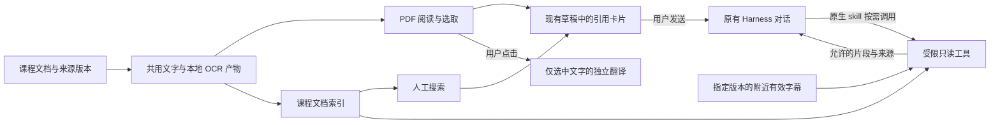

# DeepTutor 与 DeepStudent 具体借鉴方案

日期：2026-10-22。范围：结合现有需求与当前 Harness 桌面工程，确定后续设计中的复用、改造和自行实现分工。**本轮只形成方案，不开发、不安装依赖、不运行模型，也不变更工作包状态。**

后续方案入口：本文保留为前轮设计。2026-10-23 的[13 场景需求](../product/13场景学习工作台需求收口-2026-10-23.md)与[统一交付实施方案](../plans/13场景统一交付实施方案-2026-10-23.md)覆盖本文的场景暂缓、分批交付、代码复用策略及整课归纳待定表述；新方案优先原样复用、适配移植，必要时重写，并逐项列出源码候选。历史正文不作为拒绝后续确认范围的依据。

本文的设计提议不自动成为已确认产品需求。需求优先级为用户最新明确指令、[PDF／字幕／课程知识库需求收口](../product/PDF阅读与字幕及课程知识库需求收口-2026-10-22.md)、[需求总结](../product/AI辅助学习项目需求总结.md)中仍有效的决定。最新收口覆盖旧文档里应用层每轮预检索等冲突表述。工程遵守[开发规范](../development/开发规范.md)，实现与验收状态只在 [MVP 开发计划](../plans/MVP开发计划.md)维护。

## 1. 采用方式

整体方案为：**沿用现有 Harness 桌面、聊天和业务数据；借鉴 DeepStudent 的阅读选取交互、DeepTutor 的来源与恢复设计；自行实现符合本项目权限和数据契约的学习模块。**

| 分类 | 本文含义 | 当前可以确定的内容 |
| --- | --- | --- |
| 直接复用 | 沿用项目已有实现或已经锁定接入的能力，不重新建设同一套功能 | Harness 原生聊天与视觉、现有课程和会话、草稿、附件存储、请求对账、出站计量、播放器等。新增场景仍须回归。 |
| 改造复用 | 扩展已有模块，或取参考设计后按项目 Interface 改写 | PDF 引用接入现有草稿、附件来源扩展、索引状态显示、Harness skill／工具接入、局部翻译执行接入。不是把上游组件原样粘入。 |
| 自行实现 | 项目持有业务语义、状态和权限；底层引擎可使用经过验证的第三方库 | 跨页选区、版本定位、阅读文字／OCR产物、后台任务、字幕有效修订、课程检索与授权、独立翻译操作。不是从零训练 OCR／ASR 或自写 PDF 解码器。 |
| 不采用／留待后续 | 与已确认要求冲突，或尚未进入对应范围 | 自动找题、每题预检索、自动联网补救、默认多代理／计划门槛、自动取视频画面，以及笔记／卡片／复盘等新增产品。 |

**两个参考项目目前没有被核定为可以整模块直接移入的代码。** 上轮只核了固定源码及文档，没有完成逐文件依赖和迁入运行验证。因此，“可直接复用”主要指本项目与 Harness 既有能力；参考项目提供的可复用资产主要是设计、字段语义、状态划分和测试场景。小段纯逻辑只有在实际迁入时通过来源、依赖、许可与行为核对，才列为代码复用。

## 2. 当前工程基础与真实缺口

本方案以本次读取的未提交工作区为基线，包含其他线程已完成的桌面迁移和最新精简视觉；不覆盖那些改动，也不假设它们已提交。

| 现有基础 | 后续沿用位置 | 尚不能据此声称具备的能力 |
| --- | --- | --- |
| Harness 原生输入、消息、模型选择、流式输出与停止；本项目课程／聊天映射 | [桌面接入](../../desktop/README.md)、[桌面网关](../../backend/src/learning_app/desktop.py)、[执行适配](../../backend/src/learning_app/execution/adapter.py) | 原生 skill 已接通；无聊天消息副作用的独立翻译执行。 |
| 课程根目录、文件整理、稳定资源身份与来源版本 | [课程文件](../../backend/src/learning_app/course_files.py)、[业务存储](../../backend/src/learning_app/storage/repository.py) | 课程全目录增量索引、排除规则、PDF 区域与字幕修订定位。 |
| 自动草稿、修订冲突、图片附件、回答精确引用 | [草稿](../../backend/src/learning_app/drafts.py)、[桌面草稿桥接](../../desktop/client/draft-bridge.js)、[回答引用](../../desktop/client/answer-quotes.js) | PDF 文字选区就是现有 `DraftReference`；该类型当前绑定回答消息及 Markdown 源范围。 |
| 整份 PDF／TXT／Markdown 附件准备、完整性校验和出站展开 | [文档附件](../../backend/src/learning_app/documents.py)、[本地准备](../../backend/src/learning_app/document_processing.py) | 内嵌 PDF 阅读、文字层、OCR、跨页选择。现有整份附件 PDF 上限为 32 页，不能直接用作教材阅读限制。 |
| 固定 `pypdfium2==5.14.0`、自有 worker／进程管理及不可变图像存储 | [依赖声明](../../backend/pyproject.toml)、[依赖锁](../../backend/uv.lock)、[进程管理](../../backend/src/learning_app/processes.py) | PDFium 现有整份栅格化路径已经满足阅读、选字、搜索和局部高清裁剪。 |
| 本地预览缓存、检查点、前台优先信号、所属子进程清理 | [视频预览](../../backend/src/learning_app/video_previews.py) | 已有可承担 OCR／ASR／索引的统一持久队列；预览实现只覆盖其专用任务。 |
| profile 禁用 skill，guard 拒绝工具，执行边界保留实际出站与 raw usage | [profile](../../harness/profiles/learning.patch.json)、[guard](../../harness/plugins/learning-guard.mjs)、[出站边界](../../backend/src/learning_app/execution/boundary.py) | 写入两份 skill 文件即可读取资料；启用工具后现有零工具断言仍能原样沿用。 |

底座继续遵守 [Harness 制品锁](../../harness/runtime.lock.json)与[桌面锁](../../harness/desktop.lock.json)。参考源码提交和实际客户端 build 身份不同，不把源码能力说明当作固定运行制品的兼容结论。React、主题与构建沿用本项目锁文件，本轮不引入另一套 React、Tauri 或状态仓库。

## 3. 逐项借鉴与实现分工

下表编号仅供方案内追踪，不是新的 MVP 工作包，也没有“进行中／已验证”含义。上游依据的固定链接集中在第 9 节。

| 编号／能力 | 分类 | 复用什么、借鉴哪里 | 具体改造或自行实现内容 |
| --- | --- | --- | --- |
| A01 聊天、视觉、模型与思考选择 | 直接复用 | 当前 Harness 原生组件和项目执行映射 | 新阅读操作只向现有草稿加入内容；不替换聊天循环、输入框或消息渲染，不增加默认规划和辅助模型。 |
| A02 课程目录、文件、标签页、视频与来源跳回 | 直接复用为主 | 现有课程、文件、播放器与来源版本能力 | PDF 作为中间区的资料类型接入；同一时刻展示一个文件，切离视频按既定暂停规则。目录整理和课程聊天规则不重新设计。 |
| A03 PDF 连续阅读与常规导航 | 改造复用＋自有阅读 Module | 已固定 PDF 引擎、现有资料壳；参考 DS-1 的阅读动作布局 | 提供连续滚动、页码／目录、缩放／适宽、旋转、搜索和每文档阅读恢复。现有栅格化只是可复用底层材料；文字层／坐标能力经固定引擎验证后接入，不复用整份附件限制。 |
| A04 文字选区加入草稿 | 改造复用 | DS-1／DS-2 的“选区快照＋来源”；现有草稿修订和提交事务 | 新增文档选区类型，跨页文字形成一张卡片并保存逐页定位；可选编辑，不强制检查。去重考虑来源版本和位置；不搬上游 20,000 字符截断。 |
| A05 公式／图形多区域框选 | 改造复用＋自行实现定位 | 项目图片确认、不可变存储和重裁思路；DT-1 的局部定位 | 按页映射局部矩形，渲染实际选区图片，逐卡加入草稿；多个不连续区域不拼长图。不能误走“整份文档”展开，也不能仅裁显示缩略图影响公式清晰度。 |
| A06 原文回链、来源变化与历史引用 | 自行实现统一定位，复用资源身份 | DT-1 的摘要／页序／区域；项目 `asset_id/source_version` | 保存页序与显示页标签、区域和已提交快照。来源移动保持身份；同名换内容标为新版本，旧引用不静默更新；源失联仍保留引用内容。 |
| A07 划词／划句翻译 | 自行实现操作生命周期，改造执行接入 | DS-3 的附近浮层、取消与迟到回调隔离；项目请求对账和出站计量 | 只在点击后调用，材料只含当前所选／用户编辑后的文字。翻译和“加入 AI”独立；不自动补前后文，不生成隐藏学习对话，不在翻译结果内新增“继续问 AI”。 |
| A08 本地 PDF 文字／OCR产物 | 自行实现产物管理，复用引擎 | 当前 PDF worker／进程管理；DT-2 的缓存身份思路 | 优先读取可靠文字层，扫描页本地 OCR；当前页优先、后台逐页、可暂停和单页重试。保存字词坐标及覆盖信息，供选字、搜索和索引共用。OCR 引擎本身采用验证后固定的库／模型。 |
| A09 后台持久任务与前台让行 | 自行实现，复用现有进程与优先信号 | DT-2 的检查点和候选发布，现有预览任务的实际经验 | 面向 OCR／ASR／索引建立最小持久处理入口和唯一任务身份，统一资源仲裁并协调现有预览 worker。不为此批量重构所有后台，也不建立通用插件任务平台。 |
| A10 本地字幕、显示及手改 | 自行实现业务与调度，复用媒体身份和播放器 | DS-5 的实际时间回链；项目视频版本、整数毫秒与位置恢复 | 本地 ASR 分段、当前观看优先、持久进度；原始转写、手改及有效修订分开，后台不能覆盖手改。已有手动字幕保留；不采用 DS 外部 ASR 工具。 |
| A11 附近字幕 skill | 改造 Harness 接入＋自行实现只读工具 | 原生 skill 机制；DS-4／DS-5 的任务描述与来源说明 | 锚定提交的视频版本和时间戳，读取有限附近字幕；未就绪时优先补必要小段，课程批量队列原暂停状态不复活。禁止取图像；不建立整课字幕知识库。 |
| A12 课程索引、排除和增量维护 | 自行实现业务，复用解析产物 | DT-2；DS-6 的状态展示；项目课程目录和来源版本 | 可解析课程 PDF／TXT／Markdown 默认排队，支持排除文件／子目录；不索引临时附件、聊天和截图。后续 PPT／Word 沿用同一 Interface，当前不引入转换链。 |
| A13 人工课程搜索与结果卡片 | 自行实现检索入口与结果，改造文件 UI | DS-6 的状态分层、DT-3 的检索评价 | 返回原文、资料名、页码／区域与覆盖；可打开原文或加入现有草稿。关键词和语义召回按固定样例比较，不搬自动题号找题分支和数学文本过滤阈值。 |
| A14 课程知识库 skill 与文档图文读取 | 改造 Harness 接入＋自行实现授权 | DT-1 的局部来源，DS-4 的渐进加载思想 | 与人工搜索共用受限检索 Module；文字命中后可读取关联 PDF 公式／图表局部。严格区分手动选区与文档检索许可，默认当前课程，跨课程仅按明确授权。 |
| A15 索引构建、验证与发布 | 自行实现协议，按引擎接入 | DT-2 的来源／解析参数身份、验证候选后发布 | 解析缓存可复用，索引按版本构建；候选探针通过再切活动引用。故障保留旧产物，但旧来源已变更时不得继续冒充当前可用索引。 |
| A16 检索与学习效果验证 | 自行实现项目样例与薄评测入口 | DT-3 的金标准原段及生产检索路径 | 同一查询走实际受限检索 Interface，记录失败、覆盖、原段召回、定位和最终回答。不能复制上游课程数据或拿其分数当本项目效果。 |
| A17 断线、取消、滚动阅读体验 | 直接复用为主，只按缺口改造 | 现有对账／水位／取消；DT-4 的事件回放和晚布局滚动场景 | 用作回归清单：继续查看原生成、保留部分正文、用户向上阅读不被拉回。先验证当前原生实现，不整迁上游传输客户端或 React hook。 |

对尚未实施的整体导出／导入、离线聊天、数据迁移、Windows 完整交付等既有需求，本方案只要求新引用、手改和产物身份能纳入项目业务数据；不借本次参考项目调查启动这些工作，也不宣称其备份功能可直接满足本项目完整需求。

## 4. Module 与 Interface 设计提议

这里描述后续实现应提供的语义，不定义正式路由、数据库表或独立 DTO 真相源。实际字段由正式 Pydantic 源码与生成 OpenAPI 维护，遵守[应用契约](应用契约.md)。

### 4.1 资料与来源定位

沿用课程／资源 Module，在其 Interface 后面隐藏磁盘路径、PDF 引擎对象、源文件核验和区域变换。阅读器、人工搜索和模型工具都使用业务身份；模型不能传任意本地路径。

后续文档定位应表达：课程与资料身份、来源版本、页序、显示页标签，以及逐页文字范围／矩形。坐标保存到统一的原始页面坐标系，显示缩放、旋转和像素转换由阅读 Implementation 处理。不能只保存当前 DOM Range 或起始页；同一文本在不同页／版本不得因文本 hash 相同而混为一个来源。

用户编辑仅产生本次引用的新内容修订，保留选取来源与原始快照关系；不写回 PDF、不替换全文 OCR。编辑后的内容不能伪装成未经修改的原文。

### 4.2 五条输入路径分开校验

| 输入路径 | 允许读取什么 | 内容何时进入模型 |
| --- | --- | --- |
| 视频／屏幕截图 | 用户实际确认的矩形及允许的已提交历史 | 现有显式发送路径；预览帧和封面不成为许可。 |
| PDF 手动文字／图片选区 | 所选文字快照或各个局部图片；来源信息用于回看 | 加入草稿不出站；显式发送时仅展开这些选区，不凭资料 ID 补整页或全文。 |
| 整份文档附件 | 继续遵守用户明确选择整份的现有完整性与上限 | 现有整份提交路径；超限拒绝，不自动改成选区或检索。 |
| 课程文档检索 | 允许课程内的文字命中片段、必要的关联局部图像 | 仅在原生 skill 调用受限工具后；许可不反向扩大手动选区，也不覆盖视频。 |
| 附近字幕 skill | 本次问题绑定的视频版本及有限时间窗内的有效字幕 | 仅在工具被调用后；无取帧／屏幕读取能力。 |

局部翻译另有独立材料范围：只发送选中的文字；固定翻译指令、语向与用户所选模型参数不意味着可以补文档正文或聊天历史。

权限来自服务器按提交／课程来源生成的可信绑定，不能由模型填一个 `course_id`、客户端标签或提示词自行授予。原生 skill 的发现／加载只提供指令，不绕过上述读取权限。

### 4.3 文档阅读与解析产物

阅读 Module 提供打开指定版本、显示与导航、读取可用文字、创建选区和打开定位的 Interface；解析 Module 隐藏文字层／OCR 引擎差异，返回逐页文字、坐标、产物修订、覆盖及错误。

优先复用现有固定 PDFium 作为后端渲染验证起点，但现有附件准备器受整份上限、输出边长及累计像素限制，不能直接承担大教材阅读。后续应在该实现附近形成按页读取／渲染能力，保持整份附件路径原语义。若文字层或前端阅读能力需要补充引擎，先验证固定制品、坐标一致性和依赖闭包，再通过内部 Adapter 接入；本轮不凭上游用了某库就锁定整套阅读栈。

阅读、搜索与索引共享同一来源版本的解析产物。产物身份包含来源版本、解析器／模型／参数和产物格式修订；索引更换召回方法不应重复 OCR。当前页未识别仍能显示与框选；搜索标明已覆盖范围，不等待全书完成。

### 4.4 草稿与引用

继续由原草稿 Module 处理正文、附件、修订冲突及提交。新增文档选区应有明确类型／身份，保存内容快照及定位；现有回答引用 `DraftReference` 继续只承担原语义，不把 PDF 来源塞成假的 `message_id`，也不借无约束 metadata 绕开校验。

图片字节尽量复用现有不可变附件存储；来源类型和裁剪校验需扩展为 PDF，不伪造为视频截图。只选取并加入当前草稿，不额外弹确认识别步骤。跨页文字为一张卡片，多个独立图片框各一张；翻页、换选取方式和 AI 收放不清空草稿。

提交一次性绑定本次内容、来源、原聊天、模型与思考参数。切课后的迟到准备／OCR／翻译结果不能写入新课程草稿；原生成和其工具读取仍归原提交，不跟随当前 UI 课程变化。

### 4.5 后台任务与字幕

后台处理 Module 隐藏 worker、模型资源和检查点。Interface 应支持安排任务、查询覆盖、暂停／继续、取消本次需求；任务身份绑定来源版本、处理类型、页／段范围及处理配置，重复打开不重复整份处理。

任务运行状态与资料可用覆盖分别表达：任务暂停也可能已有部分可用；某页失败不等于全资料失败；没有命中不等于未处理。每页／段完成经核验后发布检查点，崩溃恢复不覆盖已提交产物；源更新后旧 worker 的完成回调不能发布到新版。

播放、截图、当前问答优先；跳到新页或请求附近字幕可安排必要小任务。手动暂停的批量任务保持暂停，临时小任务结束不恢复整队。预览 worker 接受相同前台优先约束；利用其已有进程控制，不把邻近帧缓存接成模型工具。

字幕保存原始 ASR 与手改有效修订。tool 读取返回具体片段、整数毫秒、来源版本和有效修订；重新转写不能覆盖手改。ASR 只处理必要音轨，不向主模型发送视频，不增加字幕 AI 纠错调用。停止本次等待与暂停整课后台是不同动作，不能互相替代。

### 4.6 课程检索与 skill 接入

检索 Module 的小 Interface 包括查询允许范围、读取命中片段／图像和查询覆盖状态；人工搜索与原生技能共用同一实现，隐藏全文／向量索引及解析库对象。搜索结果包含可检查原段、来源版本、定位、片段身份和覆盖状态，不能只给生成摘要。

首个本地检索基线优先验证准确术语及改述问题；是否增加本地语义索引、模型、重排和切段参数由同一组样例比较后固定。保持必要假设和章节关联，不能直接继承“数学符号多即低质量”的过滤规则。没有实测收益前，不加入模型生成片段背景或检索模型先回答的额外步骤。

课程目录的可解析资料默认安排索引，新增／变更／改名／移动／排除／失联在目录增量或启动对账中处理；不能把每次模型提问作为重扫整课的触发器。排除状态在检索与后续读取两处重验。旧索引可保留用于恢复，但源已变更或被排除时不再作为当前课程依据返回。

两份项目 skill 分别描述“附近字幕”和“课程资料检索”，沿用 Harness 原生名称／描述发现、加载与显式调用；不增加必须手动开启的总开关，不从 DeepStudent 迁入技能管理器。具体步骤是后续改造事项：

1. 对固定 Harness 制品核实受控 skill 来源与加载接点，不能直接放开任意磁盘技能发现。
2. 注册项目只读读取工具；将当前“一律无工具”的 guard 和相关断言改为明确白名单，同时继续拒绝 shell、通用文件、任意网络、自动补帧和子代理。
3. 将可信提交绑定、工具事件与出站记录接入既有执行适配。工具结果触发的每次实际模型请求分别记录 attempt；多个工具结果合并为一次请求时不按工具数量虚增。同一 generation 可关联多个实际 attempt，不重复累计流式 usage。
4. 验证发现、加载、调用、取消、重连和拒绝路径的完整固定制品组合。做不到时报告具体不兼容点，不静默绕成应用层预检索，也不取消 Harness 主线。

工具未命中返回“本次未找到”；模型可按需求标为通用解释继续回答。用户限定只依据资料时不能补自身知识结论；未就绪／失败／过期和未命中分开，也不自动联网。字幕时间窗和有限扩展值作为后续工程验证参数，不能自行扩到整课。

### 4.7 局部翻译执行

局部翻译单独有请求身份、选区内容修订、取消状态和结果归属，复用现有模型凭据、出站审计及可用执行接点。独立浮层没有现成受控执行能力时，后续在执行适配后实现专用操作，不绕过原出站边界另起供应商客户端。

翻译不复用带学习历史的活动会话作为模型上下文，避免连带发送未选择的历史资料；必要的内部执行上下文由 Adapter 管理，不新增用户可见的学习聊天，也不把译文写入当前对话历史。

点击才调用；同一待定点击先对账，不自动重发。切换选区或关闭浮层阻止旧结果覆盖新结果，实际停止须确认下游取消，不能只关闭前端流。请求开始时固定用户所选模型和思考，不因翻译轻量自动降级；保存实际 attempt、raw usage 和字段存在性，取消缺失用量仍为未知。结果不自动存笔记、制卡或加入聊天。

## 5. 可复用代码与外部依赖的具体结论

| 对象 | 本方案采用方式 | 迁入前仍需证明的内容 |
| --- | --- | --- |
| 项目现有 Harness／课程／草稿／存储／出站实现 | 作为真实复用基础；扩展时保持现有行为 | 新类型和工具续答不会破坏幂等、来源、取消和用量；原生输入组件仍为同一实例。 |
| 现有 PDFium、图像存储、OwnedProcessGroup | 优先复用；扩展按页与区域能力 | 文字／扫描／混合文档、旋转／缩放坐标与公式清晰度；大书阅读不被整份提交上限误拒。 |
| DeepStudent `PdfSelectionActions`／`selectionRef` | 复用交互和快照设计，项目内改写；不整文件移植 | 跨页、版本、完整性、原生草稿接入；去掉前后文扩充及过长静默截断。 |
| DeepStudent 翻译浮层、状态 UI、字幕回链 | 借交互和竞态处理思路，复用本项目视觉与协议 | 不带入 Tauri IPC、独立状态库、新会话策略、外部 ASR及宽泛联网策略。 |
| DeepTutor `SourceRef` | 借版本／页码／局部区域语义，按本项目身份自行定义 | 不照搬 `kb_ref/document_key` 作为跨模块业务身份；历史引用与失联原件另验。 |
| DeepTutor 索引恢复 | 借检查点与候选发布设计；按本项目存储实现 | 上游文档不是本项目崩溃恢复证据；文件与数据库故障窗口均需验证。 |
| DeepTutor 评测结构／生产路径原则 | 借金标准原段和实际检索入口，写项目薄评测适配 | 不导入其应用运行层；所有失败与覆盖应单列，不能靠排除失败美化分数。 |
| DeepTutor 事件客户端与自动滚动 hook | 作为原生界面行为对照与用例 | 仅有真实缺口才局部改造，避免多一套会话传输／滚动状态。 |
| OCR／ASR／检索底层库和模型 | 使用经过验证、固定版本的现成引擎；业务管理自行实现 | 本轮未选择引擎、下载模型或评测，不以“自行实现”隐含自研基础算法，也不照搬上游默认组合。 |

上游根许可分别为 DeepTutor Apache-2.0、DeepStudent AGPL-3.0，固定许可文件见第 9 节。本轮无代码复制。后续实际复制须记录文件／提交／修改范围／依赖和原通知，按项目交付方式核适用要求；不能把设计参考等同于已批准整段代码迁入，也不把文件依赖核查留到发布之后。

## 6. 后续文件责任建议

以下是实施时的落点建议，**未创建任何这些新代码目录或修改运行配置**。先在既有模块附近形成小的纵向功能，只有实现规模需要时再拆包，不预建通用框架。

| 位置 | 建议责任 | 处理方式 |
| --- | --- | --- |
| 现有 `frontend/src/library/` 与资料展示壳 | PDF 资料打开、标签切换、检索入口与状态 | 改造；在 Harness 桌面学习构建中复用同一实现与主题。 |
| 拟新增 `frontend/src/documents/` | PDF 连续阅读、文字层／选区、局部框选、翻译浮层、定位回看 | 自行实现交互 Module，内部封装阅读引擎；不创建新聊天页。 |
| 现有 `drafts.py`、`desktop/client/draft-bridge.js`、`desktop.py` | 文档选区身份和草稿投影，保持旧回答引用与整份附件 | 小范围改造；先核原生数据模型扩展接点，不能靠丢弃字段维持表面显示。 |
| 现有 `documents.py`、`document_processing.py` 附近 | 拆清整份附件与阅读按页／区域准备，共用底层核验 | 改造；保持整份提交限制和历史行为。 |
| 拟新增后台文档／字幕／检索 Modules | 产物、版本、任务和只读读取 | 项目自行实现；内部 Adapter 接固定引擎，不泄漏第三方对象和绝对路径。 |
| 现有 `storage/` 及后续新增迁移 | 选区快照、逐页产物、任务检查点、字幕修订、索引活动版本 | 沿用唯一业务存储；追加迁移，不重写历史迁移。产物删除规则不得删除用户引用与手改。 |
| `harness/profiles/`、`harness/plugins/`、`execution/` | 受控 skill、白名单工具、可信提交绑定、事件和用量 | 按固定制品接入；只打开必要能力，不放开整个工具面。 |
| `contracts/` 与对应测试目录 | 新公开类型、确定性 fixture、真实调用记录与对账 | 从正式源码生成契约；文档不另写一套手工 schema。 |

## 7. 建议验证顺序与交付条件

这是依赖顺序提议，不是已确认的知识库首批任务清单或已启动的排期。后续获得开发授权后，映射到唯一 MVP 计划再执行；PDF／OCR 与字幕／ASR可以独立推进，不要求全课转写作为 PDF 前置。

| 顺序 | 最小纵向结果 | 主要依赖及结束条件 |
| --- | --- | --- |
| 1 阅读与手动引用 | 打开 PDF → 文字跨页／多图片选区 → 现有草稿 → 原生发送 → 来源回看；文字选择可单独翻译 | 先明确定位和输入类型。文字层 PDF、本地扫描 OCR分别验证；不能只交文字 PDF就宣布已满足扫描选字。 |
| 2 可恢复解析与前台优先 | 当前页优先、后台逐页、暂停／单页失败恢复、已有产物复用 | 从第 1 步起就保存来源和逐页产物，不先做只能全书重跑的临时方案。与既有播放／截图／问答并行验。 |
| 3 字幕与附近 skill | 本地分段转写、显示手改、附近读取、时间回链 | 字幕生产、读取权限与固定 Harness skill接入分别验证；手动暂停整课后临时按需片段不恢复整队。 |
| 4 课程检索双入口 | 默认资料索引、排除与增量、人工搜索／引用、原生知识库 skill | 复用解析产物与第 3 步已验证的接入方式，具体首批学习任务仍待落实；字幕不进入此索引。 |
| 5 恢复、版本与真实学习回归 | 来源替换／移动／失联、后台故障、断线与停止、实际学习与用量 | 关键故障测试随各步实施，最后做组合回归，不能把来源和权限问题拖到最终才补。 |

至少保留以下验收项；本轮均未执行，不填通过：

| 场景 | 必须检查的结果 |
| --- | --- |
| 跨页文字，含旋转／缩放 | 一张文字卡片保留各页范围与顺序，原文定位正确，不自动加相邻文字。 |
| 多页多个图片框 | 独立图片及位置可核，草稿不丢失，实际输入无框外图像；已提交视频图片规则不变。 |
| 选区编辑与超限 | 可选修正产生引用修订，原 PDF 不变；过长明确拒绝或由用户缩小选择，不静默截断。 |
| 大教材阅读和整份附件 | 大教材阅读不直接套32页限制；显式整份附件仍按其现有上限和完整性拒绝，二者不互相降级。 |
| 局部翻译 | 只点击才出站，材料只含所选文字；关闭、换选区、结果未知、取消和迟到回调可对账。 |
| 部分 OCR 与搜索 | 未处理／失败／过期／未命中分开；当前页可用且不等全书，重复打开复用结果。 |
| 源同名替换、排除或失联 | 新检索不返回无效来源；旧聊天保留原快照，回链明确提示而非跳新版。 |
| 数学资料召回 | 相似定理不同假设可区分，必要条件不被切掉；公式密集片段不因通用过滤静默消失，图文定位正确。 |
| 取消与进程恢复 | 只处理所属任务，已提交检查点保留；源更新后的迟到回调拒绝，用户暂停不复活。 |
| 课程切换与权限负例 | 原问题仍绑定原课／原版本；任意路径、越课、超窗、整课字幕、视频补帧均由执行层拒绝。 |
| skill 触发与无调用路径 | 普通手动截图问答没有应用层预检索；工具未调用时不偷读资料。加载 skill 不授予通用文件／网络权限。 |
| 工具续答与计量 | submission／generation／各 actual attempt 可核，重连不重发；raw usage 按每次实际出站保留，缺失未知，不累计流式重复值。 |
| UI 与前台体验 | Harness 原生输入／消息组件稳定，滚动阅读不被打断；处理进度按需显示，不增加常态调试信息。 |

确定性本地 fixture、合成浏览器、固定 Harness 实际工具调用、真实模型、Windows 实窗及用户学习体验分别记录。索引通过不代表数学答案通过；静态代码、官方设计与 mock不代替运行证据。实际材料和外发范围遵守现有授权，不能为测试补视频画面。

## 8. 本轮不扩大范围与保留的工程待验证项

不采用 DeepTutor 自动找题、附加库预检索、强制计划／逐步 gate、另一个视觉模型先转文字；不采用 DeepStudent 的自由多窗口、统一记忆检索、默认联网补足、媒体新会话和外部 ASR链路。笔记、卡片、导图、复盘、自测、统计、B站导入、Android／同步、批注不由此启动。

具体 OCR／ASR／检索引擎、切段与时间窗、性能参数仍由工程验证确定；这是技术选择，不需要把每个参数交给用户决策。整章／整课完整归纳是否随知识库首批交付、首批学习任务清单仍是产品待定项，本文不代为决定。需要完整归纳时须新增明确范围枚举与覆盖验证，不能拿少量召回片段冒充全章已读。

本方案没有性能、费用节省或开发工期承诺，也没有证明固定 Harness 新工具接入已经兼容。下一次进入实施前，先合并最新需求收口与其他线程交付，再同步持续维护的需求、契约、计划和验证文件；这次只新增方案与导航，不把方案编号写成已开工工作包。

## 9. 固定源码与研究依据

参考上轮已核源码快照：DeepStudent `635216503c0b34bdf812e17942e0f09f51872e6f`，DeepTutor `a31d82624c27d75f4e771d4fcb78dce16470b383`，均为 2026-10-18 提交；本轮不宣称重新核了远端最新版。源码事实、文档说明及未知项见[综合研究](../../research/topics/DeepTutor与DeepStudent项目借鉴分析-2026-10-22.md)、[DeepStudent 证据](../../research/topics/DeepStudent源码借鉴分析-2026-10-22.md)和[DeepTutor 证据](../../research/topics/DeepTutor源码借鉴分析-2026-10-22.md)。

| 标记 | 一手依据 | 本方案用途 |
| --- | --- | --- |
| DS-1 | [PDF 选区动作](https://github.com/helixnow/deep-student/blob/635216503c0b34bdf812e17942e0f09f51872e6f/src/features/pdf/components/PdfSelectionActions.tsx#L144-L244) | 选区加入草稿、起始页定位和翻译前后文的取舍。 |
| DS-2 | [选区快照与序列化](https://github.com/helixnow/deep-student/blob/635216503c0b34bdf812e17942e0f09f51872e6f/src/features/chat/context/selectionRef.ts#L36-L112) | 来源参与身份、补版本／跨页、拒绝静默截断。 |
| DS-3 | [翻译浮层](https://github.com/helixnow/deep-student/blob/635216503c0b34bdf812e17942e0f09f51872e6f/src/features/chat/components/TranslationPopover.tsx#L1-L35)、[请求参数](https://github.com/helixnow/deep-student/blob/635216503c0b34bdf812e17942e0f09f51872e6f/src/features/chat/components/TranslationPopover.tsx#L540-L552) | 竞态／取消思路；不继承自动扩充语境。 |
| DS-4 | [技能渐进加载](https://github.com/helixnow/deep-student/blob/635216503c0b34bdf812e17942e0f09f51872e6f/src/features/chat/skills/progressiveDisclosure.ts#L73-L113) | 借发现／加载分工，不迁入管理器。 |
| DS-5 | [字幕序列化](https://github.com/helixnow/deep-student/blob/635216503c0b34bdf812e17942e0f09f51872e6f/src-tauri/src/media/transcript.rs#L1-L48)、[媒体 ASR 声明](https://github.com/helixnow/deep-student/blob/635216503c0b34bdf812e17942e0f09f51872e6f/src/features/chat/skills/builtin-tools/media-tools.ts#L15-L25) | 时间回链可借；外部转写链不用。 |
| DS-6 | [索引状态](https://github.com/helixnow/deep-student/blob/635216503c0b34bdf812e17942e0f09f51872e6f/src/features/learning-hub/views/IndexStatusView.tsx#L102-L108)、[数学文本过滤](https://github.com/helixnow/deep-student/blob/635216503c0b34bdf812e17942e0f09f51872e6f/src-tauri/src/vfs/indexing.rs#L130-L191) | 借状态展示，不照搬阈值。 |
| DT-1 | [SourceRef](https://github.com/HKUDS/DeepTutor/blob/a31d82624c27d75f4e771d4fcb78dce16470b383/deeptutor/services/rag/source_pages.py#L24-L54) | 来源版本与局部定位字段语义。 |
| DT-2 | [索引恢复设计](https://github.com/HKUDS/DeepTutor/blob/a31d82624c27d75f4e771d4fcb78dce16470b383/docs/INDEXING_RECOVERY.md) | 检查点、缓存身份与候选发布；仅文档证据。 |
| DT-3 | [评测 runner](https://github.com/HKUDS/DeepTutor/blob/a31d82624c27d75f4e771d4fcb78dce16470b383/deeptutor/services/rag/eval/runner.py#L1-L12)、[数据结构](https://github.com/HKUDS/DeepTutor/blob/a31d82624c27d75f4e771d4fcb78dce16470b383/deeptutor/services/rag/eval/dataset.py) | 项目真实检索路径与正确原段评价。 |
| DT-4 | [事件回放客户端](https://github.com/HKUDS/DeepTutor/blob/a31d82624c27d75f4e771d4fcb78dce16470b383/web/features/chat/transport/TurnRuntimeClient.ts#L295-L386)、[滚动行为](https://github.com/HKUDS/DeepTutor/blob/a31d82624c27d75f4e771d4fcb78dce16470b383/web/hooks/useChatAutoScroll.ts#L14-L110) | 回归场景，不整体移植。 |
| 许可 | [DeepStudent LICENSE](https://github.com/helixnow/deep-student/blob/635216503c0b34bdf812e17942e0f09f51872e6f/LICENSE)、[DeepTutor LICENSE](https://github.com/HKUDS/DeepTutor/blob/a31d82624c27d75f4e771d4fcb78dce16470b383/LICENSE) | 记录来源，后续具体代码复用另核文件与依赖。 |
