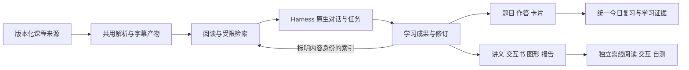

# 13 场景统一交付实施方案

日期：2026-10-23。本文将[已确认需求](../product/13场景学习工作台需求收口-2026-10-23.md)转成可执行、可审查的工程方案，**当前只写文档，尚未开发或迁入参考代码**。工作包状态唯一来源是 [MVP 开发计划](MVP开发计划.md)，本文的步骤、候选与门槛不表示已开工或已通过。

## 1. 交付原则与本次基线

S01～S13 全部满足共同门槛后统一交付。内部按模块、依赖与纵向场景推进；单个功能演示、局部试用或 mock 不能代替统一验收。完整归纳包含指定视频字幕，交互书、练习、复习、作文及调研均属本次目标，不能继续用旧“暂缓”表将其排除。

本次只读核对当前未提交工作区，现有其他线程修改全部保留。已有：固定 Harness 客户端／执行映射、课程与文件、视频与确认截图、草稿、整份文档附件、版本来源、事件对账及用量保存。尚不能视为已有：内嵌 PDF／OCR／ASR、课程检索与可调用 skill、题库、复习、作文、学习书及离线成果包。

具体基线见[桌面说明](../../desktop/README.md)、[当前应用契约](../architecture/应用契约.md)及[现有验证记录](../validation/README.md)。后续开工应重新核源码和实际锁定制品，不假设当前脏工作区与未来提交相同。

| 基础 | 继续复用 | 新场景需要的改造 |
| --- | --- | --- |
| Harness／桌面 | 原生输入、消息、模型和思考选择、主题；[固定 runtime](../../harness/runtime.lock.json)、[桌面锁](../../harness/desktop.lock.json) | 受控 skill、读写工具、学习任务与原生结果入口。参考源码 `687f282e…` 与实际客户端 build `332895e` 不视为同一制品。 |
| Python／数据 | [项目依赖](../../backend/pyproject.toml)、[uv 锁](../../backend/uv.lock)、SQLAlchemy／Alembic、[业务存储](../../backend/src/learning_app/storage/repository.py) | 追加学习资产、修订、任务、作答及复习等数据；不重写历史迁移，不建立另一套业务真相源。 |
| 前端 | [React／KaTeX 等锁定依赖](../../frontend/package.json)、原生共享 React、三栏、资料标签与现有草稿 | 在中间区接入阅读、练习、作文、学习书等视图；不能加载另一套 React 或搬入自由桌面布局。 |
| 文档与媒体 | [文档准备](../../backend/src/learning_app/document_processing.py)、[附件](../../backend/src/learning_app/documents.py)、播放器与所属进程管理 | 阅读按页和局部区域，不能将现有整份 PDF 的 32 页限制作为教材阅读上限；来源与模型摄入分别校验。 |
| 安全与执行 | [guard](../../harness/plugins/learning-guard.mjs)、[出站边界](../../backend/src/learning_app/execution/boundary.py)、[执行适配](../../backend/src/learning_app/execution/adapter.py) | 当前“无工具”基线改成有限白名单，并扩展工具续答／多 attempt 核验；不沿用全部拒绝后声称技能可用。 |

## 2. 全程 REA 与代码优先复用程序

### 2.1 三种复用方式

- **R：原样提取候选。** 可兼容的纯函数、结构与渲染片段优先保留上游代码，只加项目外部包装和必要通知；先验证其依赖与行为。
- **A：适配移植。** 保留可用的算法、解析、状态转换、UI和流程代码，替换课程身份、存储、模型、事件和运行环境依赖；跨语言移植也记录原实现及差异，不伪称自主原创。
- **I：项目自行实现。** 项目独有权限、范围、版本、统一调度、事务和复用缺口，由项目拥有 Implementation；底层库与模型仍优先用验证后的成熟实现。

每项先尝试 R，再核 A；只有不兼容、冲突或验证失败的明确证据支持时才转 I。不能因为上游是 Rust/Tauri 就预先全盘重写，也不能为保留某段代码把整个上游运行层装到 Harness 外面。

本轮已识别下表候选，但**没有任何新增上游代码已完成本项目兼容验证**。原样候选不是已经接通的功能；适配和自行实现分工是方案，不是迁入结论。

### 2.2 源码、制品与运行证据

固定参考快照：DeepStudent `635216503c0b34bdf812e17942e0f09f51872e6f`；DeepTutor `a31d82624c27d75f4e771d4fcb78dce16470b383`。沿用前轮固定提交并补查具体代码，不声称重新选择了最新发行版。

1. **源码事实**：按 REA 的源码路由使用仓库工具，登记文件／函数、提交、许可、依赖闭包与修改位置；没有二进制问题不做无关引擎诊断。
2. **制品事实**：记录实际发布包／本地构建的版本、hash、平台和运行闭包。需要分析打包 JS／原生文件时再用 REA 对应工具，不将参考源码替代制品。
3. **运行观察**：对实际本项目窗口／浏览器、声明动作和受控 fixture 留证。工具证据有 Evidence ID 时保留，否则保留工具输出、制品身份与观察记录；不得把静态阅读说成运行通过。
4. **环境故障**：仅在需要的 REA 能力确实不可用时依技能恢复指南诊断，不擅改客户端配置／全局环境；按宿主实际授权处理必要配置修复。能够继续的只读源码工作不因无关引擎缺失停摆。

复用账必须含：候选编号、源提交／文件／符号、计划 R/A/I、直接／传递依赖、原通知、目标落点、适配差异、实际验证命令和结果、证据位置、剩余缺口。账本另记录“未采用原代码”的具体理由；不设虚构复用率或节省工期。

### 2.3 已核的具体代码候选

下列链接固定到上述提交。R/A 标记仅说明优先处理方式。

| 编号 | 代码入口与可保留部分 | 方式及必须适配之处 |
| --- | --- | --- |
| C01 DS 选区 | [selectionRef.ts](https://github.com/helixnow/deep-student/blob/635216503c0b34bdf812e17942e0f09f51872e6f/src/features/chat/context/selectionRef.ts#L36-L112)：正文与 locator 参与身份、序列化和来源展示 | A。替换 sessionManager／resourceStore／事件总线，接现有草稿；增加源版本、跨页区域、内容身份，移除20,000字符静默截断。 |
| C02 DS 翻译 | [translationNdjsonParser.ts](https://github.com/helixnow/deep-student/blob/635216503c0b34bdf812e17942e0f09f51872e6f/src/features/chat/components/translationNdjsonParser.ts#L38-L141) 的字符串／转义感知扫描器；[translationCache.ts](https://github.com/helixnow/deep-student/blob/635216503c0b34bdf812e17942e0f09f51872e6f/src/features/chat/components/translationCache.ts#L18-L82) 的 LRU；浮层取消与回调处理 | 解析／LRU优先R，组件A。原扫描器忽略无效JSON、flush丢弃未闭合残片，外层须区分部分译文／解析完整／模型流完成。换Tauri执行；局部去前后文，缓存键含模型、思考、提示和选区修订，弱hash不作来源身份。 |
| C03 DS 题库 | [drafts 结果](https://github.com/helixnow/deep-student/blob/635216503c0b34bdf812e17942e0f09f51872e6f/src-tauri/src/chat_v2/tools/qbank_executor.rs#L4603-L4630)、[作答事务](https://github.com/helixnow/deep-student/blob/635216503c0b34bdf812e17942e0f09f51872e6f/src-tauri/src/question_bank_service.rs#L501-L542)、[历史提交](https://github.com/helixnow/deep-student/blob/635216503c0b34bdf812e17942e0f09f51872e6f/src-tauri/src/question_bank_service.rs#L623-L663) | A。提取题型校验、去重／OCC与题目—作答—评价事务，替换 VFS、LLMManager和旧双轨存储。明确请求后默认保存，不搬强制逐题确认或累计答对两次即掌握。 |
| C04 DS 卡片与调度 | [卡片创建、模板校验、写入与入队回执](https://github.com/helixnow/deep-student/blob/635216503c0b34bdf812e17942e0f09f51872e6f/src-tauri/src/chat_v2/tools/chatanki_executor.rs#L3221-L3376)、[fsrs_scheduler.rs](https://github.com/helixnow/deep-student/blob/635216503c0b34bdf812e17942e0f09f51872e6f/src-tauri/src/fsrs_scheduler.rs#L1-L140) 纯调度模块、[评分 CAS／幂等](https://github.com/helixnow/deep-student/blob/635216503c0b34bdf812e17942e0f09f51872e6f/src-tauri/src/fsrs_review_service.rs#L2080-L2147) | 调度优先R候选，卡片内容和持久服务A；模板字段／内容校验、创建—入队回执代码先提取，替换文档／牌组身份、VFS和模型运行依赖。纯调度依赖 chrono／fsrs；先核固定本地库／helper窄 Interface，不要求用户运行Rust开发环境。闭包不成立再以验证后的算法库移植包装；题库SM-2不自动并入。 |
| C05 DS 作文 | [轮次上下文](https://github.com/helixnow/deep-student/blob/635216503c0b34bdf812e17942e0f09f51872e6f/src-tauri/src/chat_v2/tools/essay_grading_executor.rs#L301-L359)、[原稿和结果保存](https://github.com/helixnow/deep-student/blob/635216503c0b34bdf812e17942e0f09f51872e6f/src-tauri/src/essay_grading/pipeline.rs#L521-L556) | A。提取结果解析、输入非空／长度校验和轮次流程；批注是否锚定实际原稿范围另验，不冒充上游已证实。换存储、tokio任务、事件和直接模型调用，保留评分可改和待判断。进程内任务字典不能替代持久恢复。 |
| C06 DS 讲义 | [ir.ts](https://github.com/helixnow/deep-student/blob/635216503c0b34bdf812e17942e0f09f51872e6f/src/features/media-handout/ir.ts#L30-L170)、[markdown.ts](https://github.com/helixnow/deep-student/blob/635216503c0b34bdf812e17942e0f09f51872e6f/src/features/media-handout/markdown.ts#L45-L100)、[windowing.ts](https://github.com/helixnow/deep-student/blob/635216503c0b34bdf812e17942e0f09f51872e6f/src/features/media-handout/windowing.ts#L48-L83)：块结构、列表／表格校验、Markdown渲染、字幕切块 | 纯逻辑优先R，切块及管线A。超长单行硬切后的块可能丢原时间戳，须逐chunk保存原段／时间映射并验长段fixture；枚举完整不等于内容与来源映射完整。替换媒体引用与存储，保留毫秒和版本；删自动抽帧／高清重抽／临近帧吸附和缺图静默省略，不继承隐式重试。 |
| C07 DT 来源 | [SourceRef、SourcePageError、source_digest](https://github.com/HKUDS/DeepTutor/blob/a31d82624c27d75f4e771d4fcb78dce16470b383/deeptutor/services/rag/source_pages.py#L24-L103) | 摘要函数优先R，对象／页读取A。替换知识库路径与授权，映射本项目身份；crop增加坐标语义、范围和顺序校验，支持跨页与源版本。 |
| C08 DT 评测 | [EvalCase／EvalDataset／load_dataset](https://github.com/HKUDS/DeepTutor/blob/a31d82624c27d75f4e771d4fcb78dce16470b383/deeptutor/services/rag/eval/dataset.py#L39-L245)、[metrics.py](https://github.com/HKUDS/DeepTutor/blob/a31d82624c27d75f4e771d4fcb78dce16470b383/deeptutor/services/rag/eval/metrics.py#L27-L214) 的 recall／precision／nDCG／MRR／AP及聚合函数 | 纯函数／数据集优先R，只需标准库／Pydantic的边界已核。换错误码、样例和受限检索入口；注明precision分母，失败单列，不将词面命中当数学等价或完整覆盖。 |
| C09 DT 学习事务 | [InteractionStatus／MasteryInteraction／MasteryEvent／PendingQuestion](https://github.com/HKUDS/DeepTutor/blob/a31d82624c27d75f4e771d4fcb78dce16470b383/deeptutor/learning/models.py#L240-L398) | typed对象提取后A。移除不需要的旧格式懒加载，映射课程／任务／作答，新增评价修订及用户改判；不复制其最近五次加权率或硬门槛为本项目掌握真值。 |
| C10 DT 学习书 | [Book／Spine／Chapter／Page／Block等模型](https://github.com/HKUDS/DeepTutor/blob/a31d82624c27d75f4e771d4fcb78dce16470b383/deeptutor/book/models.py#L176-L581)、[状态聚合](https://github.com/HKUDS/DeepTutor/blob/a31d82624c27d75f4e771d4fcb78dce16470b383/deeptutor/book/compiler.py#L455-L471) | 对象／纯查找／状态聚合优先R或小范围A；[compiler流程](https://github.com/HKUDS/DeepTutor/blob/a31d82624c27d75f4e771d4fcb78dce16470b383/deeptutor/book/compiler.py#L265-L346)适配移植。替换直接模型工厂、BookStorage、事件与重试；SourceAnchor补版本／区域，源探索失败须暂停。 |
| C11 DT 可视化协议 | [RendererRef／VisualizationEnvelope等协议与校验](https://github.com/HKUDS/DeepTutor/blob/a31d82624c27d75f4e771d4fcb78dce16470b383/deeptutor/visualizers/protocol.py#L88-L171) | 数据对象、序列化和有界校验优先R/A。增加项目来源／资产修订；schema依赖需固定，禁远端引用；结构通过不等于内容安全或数学正确。 |
| C12 DT 可视化显示 | [VisualizationViewer.tsx](https://github.com/HKUDS/DeepTutor/blob/a31d82624c27d75f4e771d4fcb78dce16470b383/web/components/visualize/VisualizationViewer.tsx#L26-L492)：去fence／多SVG拆分、Chart解析和具体展示片段 | 小函数优先R，展示A。换Next动态加载／主题／i18n，资产本地化；严格JSON，不默认宽松修复。自写SVG过滤不能未经验证当安全边界，iframe消息来源／类型／payload须核。 |
| C13 DT 研究 | [TopicStatus／TopicBlock／ToolTrace／DynamicTopicQueue](https://github.com/HKUDS/DeepTutor/blob/a31d82624c27d75f4e771d4fcb78dce16470b383/deeptutor/agents/research/data_structures.py#L44-L561)：主题去重、限制、统计与转换 | 纯正规化／相似度函数优先R，队列与序列化A。换naive时间为项目UTC，持久检查点接数据库／CAS；有save函数不证明运行自动恢复，新加来源缺失待决定状态。 |
| C14 DT 索引／流恢复 | [索引恢复设计](https://github.com/HKUDS/DeepTutor/blob/a31d82624c27d75f4e771d4fcb78dce16470b383/docs/INDEXING_RECOVERY.md)、[turn游标回放](https://github.com/HKUDS/DeepTutor/blob/a31d82624c27d75f4e771d4fcb78dce16470b383/web/features/chat/transport/TurnRuntimeClient.ts#L295-L386)、[自动滚动](https://github.com/HKUDS/DeepTutor/blob/a31d82624c27d75f4e771d4fcb78dce16470b383/web/hooks/useChatAutoScroll.ts#L14-L110) | 先对照既有实现；真实缺口才提取局部代码／适配，不再造整套传输。索引恢复先核实际代码与选定引擎，再移植可用实现；文档设计单独标注。 |

上游根许可见 [DeepStudent LICENSE](https://github.com/helixnow/deep-student/blob/635216503c0b34bdf812e17942e0f09f51872e6f/LICENSE)（AGPL-3.0）、[DeepTutor LICENSE](https://github.com/HKUDS/DeepTutor/blob/a31d82624c27d75f4e771d4fcb78dce16470b383/LICENSE)（Apache-2.0）。实际复用时归档原文、文件通知、依赖许可及修改清单；依交付方式核适用要求，本轮不作尚未确定分发方式的兼容法律结论，也不以许可身份代替代码适配分析。

## 3. 13 场景的复用／改造／自实现矩阵

每行均需同时完成前台使用流程、持久数据和对应验收；C编号指第2节具体代码，G编号指第7节共同门槛。

| 场景 | 优先复用与改造 | 项目自行实现的必要部分 | 场景级验收例 |
| --- | --- | --- | --- |
| S01 教材卡点 | C01、C07，现有草稿／截图／回答引用／Harness | PDF按页读取、文字／OCR坐标、跨页引用、快照与版本守卫 | 文字／扫描／混合PDF均能选取，跨页一张文字卡片、多框图独立；手动引用材料严格限于选区，问题文字、相关已提交历史及其他授权读取分别核验；回答回到原处。 |
| S02 英语精读 | C02解析／缓存／浮层，既有模型参数和计量 | 独立翻译请求、选区许可、段落对照与范围选择，迟到流隔离 | 局部材料只有选中文字，整篇须明确指定；前段有效末段损坏／截断不报完整成功；换模型不混缓存，取消后旧结果不覆盖，可在原位置继续读。 |
| S03 网课解惑 | 现有播放器／截图／来源回跳；C06字幕序列化和切块 | 本地ASR持久任务、原始／手改有效字幕、附近窗工具与可信提交锚点 | 当前片段优先，日常问答按需读附近字幕，回链到原视频版本；无字幕不猜原话，不补视频帧。 |
| S04 完整归纳 | C06 IR／Markdown、C07、C10块状态、C13任务逻辑 | 用户范围清单、全单位读取与覆盖、全范围字幕许可、缺口暂停与选择回执 | 长文档和多视频的指定范围全部有处理记录；人为制造缺页／缺段后暂停留稿，选重试／排除／接受部分均不丢旧稿。 |
| S05 练习／错题 | C03题型／drafts／事务，C09评价对象，现有KaTeX和图像 | 题目修订、作答事件、AI评价与改判、去重提交、复习联动 | 导入／生成→持久题集→真实作答→判分／待判断→改判→重做；旧作答仍绑定旧题，模型不能伪造用户作答。 |
| S06 卡片记忆 | C04调度纯模块与评分事务、现有公式和引用 | 卡片内容／调度分离、默认入队回执、统一今日仲裁及导出 | 明确生成才建卡；保存／入队分项可核；每天总量不叠加，重复评分只计一次，暂停／恢复／撤销正确。 |
| S07 作文迭代 | C05轮次／解析／输入校验、C02流控制 | 作文稿与评价修订、批注范围锚定、采纳修改／撤销、取消恢复，错误转题／卡的显式操作 | 两稿至少两轮可对照，批注锚定实际稿；原稿和原判保留，改判有效；中断／迟到结果不覆新稿。 |
| S08 深入求解 | 原生Harness完整解答与历史；参考DT solve的步骤对象和工具接口 | 绑定题图／条件／更正的受控验证操作，保存深入任务与主对话关联 | 用户主动要求另一解法／核验后真实生效；不换模型／不丢条件，普通题不被迫增加规划、OCR或多代理。 |
| S09 可视化 | C11协议、C12具体渲染片段与可本地打包的成熟renderer | renderer白名单、资源预算／隔离、来源绑定、本地交互状态与动画worker | 静态图、参数互动、动画均有真实样例；改参数有合理变化，图形与公式一致；恶意SVG／iframe越权拒绝；离线包可用。 |
| S10 学习路线 | C09持久交互／事件、C03题目、C04复习、C10结构对象 | 建议路线编辑、知识点—材料—练习关联与证据聚合 | 可跳过、调整、看解答且不被阻断；跳过不计掌握，AI参考评估可改判，已判错与待判断分别处理。 |
| S11 连续陪读 | S01／S03的阅读模块、原生消息／输入／引用，C14滚动场景 | 当前资料与提交来源一致性、资料切换／跨源对照的许可核对 | 读→问→回原文→换资料→追问连续成立；不另建聊天，切课旧生成不写新课，阅读状态正确恢复。 |
| S12 交互书 | C10模型／块编译、C06正文、C11/C12图形、S05/S06练习卡片 | 目录确认／范围修订、用户修改保护、块级落库与连续任务、离线打包 | 一次确认目录后持续生成，已完成章先读；暂停／重启不重发；手动改块不被覆盖；书中练习不重复建另一套题库。 |
| S13 比较／调研 | C13主题队列／证据／统计，C07来源，既有Harness skill | 任务范围和外部许可、子主题检查点、证据快照、报告与来源角色 | 课程内比较不联网；明确外部研究才访问外部；报告可追溯，缺失范围不假装完成，已保存报告可编辑和检索。 |

S08 的深入验证和 S13 的长研究可以有任务专用步骤，但不原样搬 DeepTutor 的强制 solve gate、多模型流水线或所有多代理配置。用户请求复杂任务不自动授权模型选择变化或任意代码执行。

## 4. 模块、数据与权限设计

### 4.1 有限的业务 Modules

| Module | 小 Interface 及其责任 | 隐藏的 Implementation |
| --- | --- | --- |
| 来源／阅读 | 按业务身份打开指定版本、取允许单位、定位／选区与覆盖 | 磁盘路径、引擎页对象、坐标旋转缩放、缓存、文字层／OCR差异；用C01/C07及现有资源实现。 |
| 学习资产 | 建成果、读修订、按预期版本改指定范围、撤销、列来源及导出 | C06/C10/C11产物结构、内容寻址、版本事务、索引通知；不是可执行任意对象的通用插件总线。 |
| 练习／评价 | 发布题目版本、提交实际答案、保存参考评价／改判、查询证据 | C03/C05/C09、客观校验和受控AI评价；用户提交事件与模型工具严格分开。 |
| 复习／路线 | 安排／暂停／移出、取今日任务、提交用户评分、调整建议顺序 | C04、日切和CAS、每日总量仲裁、不同类型调度；一处入口不要求题目和卡片使用同一算法。 |
| 书／图形／研究 | 按明确范围生成候选内容、发布块或报告、查询任务结果 | C10～C13具体流程、renderer、证据组装；共用资产和练习，不复制聊天和供应商运行层。 |
| 持久任务／执行 | 创建明确任务、查范围／状态、暂停／恢复／取消、对账与提交结果 | owned worker、检查点、Harness绑定、真实attempt、过期回调和产物发布；不把现有预览专用队列冒充统一处理能力。 |

Interface 此处是语义约束，不是手写新协议。实际公开字段由正式Pydantic源码生成OpenAPI与前端类型；第三方模型和存储对象不穿透业务调用方。内部Adapter只为实际变化的依赖建立。

### 4.2 必须分开的数据

- **来源与范围**：沿用 course／asset／source_version，增加页序与页标签、原页面坐标、字幕整数毫秒／有效修订、显式任务范围及覆盖单元。回看定位不等于读取授权。
- **成果及修订**：内容类型、课程、原始／用户／AI身份及混合片段来源、父修订、用户编辑、来源清单、已用快照和任务归属。原文引述与AI补充分开保留，默认索引不抹掉身份。
- **练习与证据**：题目版本、实际作答、参考答案、模型评价版本／原始结果、用户改判、有效评价和争议／待判断。旧记录不因修改题目或改判被覆盖。
- **卡片与计划**：内容、来源、调度参数／修订、当前状态、用户评分事件、评分前快照和撤销关系。保存成功与入队成功是可独立恢复的结果。
- **任务和执行**：输入／范围修订、目录确认版本、单位／块状态、检查点、所有权、generation／request／attempt映射及结果未知原因。重复模型回调与重复用户操作各按稳定身份去重。
- **离线包**：包版本、成果修订、相对资源清单／hash、所需本地renderer、公式字体及来源说明；不含正式评分回传身份、凭据或运行日志。

### 4.3 原始读取与成果写入分域

服务器根据课程、提交或明确任务生成可信绑定；不接受模型自填路径／课程作为权限。日常附近字幕、课程文档检索、手动选区、整份附件、全范围归纳、外部研究分别核范围。

原始教材／视频读取仍受限只读，不能补视频帧。成果写工具只允许创建或修改本次任务的指定对象和预期版本；不允许通用文件写入、任意shell、安装插件或替用户作答。生成请求默认保存与索引，普通问答则没有额外建资产动作。

跨课明确授权只扩大指定来源范围，不把课外成果写入任意课程。切课后的原任务仍归原课程／原提交，迟到准备、生成和取消回调不能修改新课数据。已确认的历史图片与输入条件继续受原上下文规则保护。

### 4.4 索引和完整归纳各有独立契约

关键词／语义检索返回相关片段及覆盖，完整归纳则先枚举全部指定单位、读取并登记处理。C08检索指标不能替代全范围覆盖验收。数学文本过滤与切段应保留必要假设，不能直接复制DS的通用字符比例阈值。

原件与生成资产使用同一受限搜索入口，但结果保留内容角色；生成资产不反向成为原件证明，也不自动授权读取其所有祖先来源。明确整课任务可以读取指定视频全部有效字幕；这不把原始整课字幕加入日常全局索引。

源／排除状态变化时，新搜索和读取均重新核验；旧活动索引即使文件还在，也不能继续冒充当前有效来源。旧聊天与成果保留快照及失效说明，不静默指新版本。生成成果用户修改后重建其派生索引，不自动重写引用它的其他成果。

### 4.5 任务、取消和模型调用

任务状态与内容可用性分开：已完成块可读不表示整体完成。至少区分用户暂停、来源缺失待决定、实际执行失败、派发结果未知与已完成。缺口先安排受控补齐；无法补齐则保留稿暂停，重试／排除／接受部分记录明确用户决定和范围修订。

不要复制上游自动重试／源探索失败继续生成的分支。未知请求先对账，恢复只续确定尚未执行的单位；本地可确定失败的重处理与未知模型重发不混为一类。每个实际模型请求记录attempt，工具多条结果合为一次模型请求时不按工具条数虚增；流式usage不重复累计，缺失仍未知。

每任务固定用户模型、思考、输出及超时。子任务和主观评价的额外调用纳入同一实际用量账；不复制上游独立provider凭据或暗中换轻量模型。局部翻译用隔离材料上下文，不连带发送学习对话历史。任务或窗口关闭只按其语义处理，不杀整个Harness。

播放、截图和当前问答优先于批量OCR／ASR／生成；按需小段结束不能唤醒手动暂停的批量队列。复用既有预览worker及前台信号的可用部分，新增持久处理协调，不顺手批量改写预览模块。Windows使用参数列表、隐藏所属子进程和固定绝对工具路径，不改全局PATH或HOME。

### 4.6 判分与今日复习

客观题确定性判分依赖具体题目版本的有效答案；AI生成参考答案不因有标准字段就自动正确。主观题允许AI参考判分、理由、用户改判和待判断，不能将模型confidence门槛照搬为可靠性证明；测试须覆盖已知正确、错误、部分正确与不可判定案例。

已判错触发复习，待判断不算错；改判用新评价修订重新计算未来安排，保留旧作答和旧排期历史。明确生成的复习卡默认入队，保存／排期部分失败可分别恢复。用户暂停／移出状态不被后台修复或模型更新自动清除。

统一今日入口对跨课程、跨类型候选做总量仲裁和筛选，各类型保留自己的调度。工程选择FSRS或其他成熟算法时保留算法／参数版本，固定时钟fixture验证日切和时区，不擅自把DS错题SM-2当作卡片FSRS的一部分。建议路线只给顺序和证据，不设强制过关。

### 4.7 离线、可视化和导出

建议按成果类型提供可携带内容和自包含阅读／交互包：文本用可读正文与本地公式／图片，题目／卡片保留结构化数据及本地自测页面，交互书包含目录、内容块和本地资源。具体格式在固定renderer后确定，离线阅读、交互和自测三个能力都必须实际验证，不能只导出静态截图冒充交互完成。

iframe及SVG按不可信内容处理，消息核来源／类型／payload；生成图不能读取凭据、文件或业务数据，不能自动发模型请求。禁在线CDN／隐式外链依赖，导出包不调用项目后台。Manim等动画使用受控渲染worker与固定资源，Renderer不因此获得系统shell。结构校验、执行隔离和数学／教学准确性分别验收。

离线自测在包内反馈，不回传软件正式成绩／排期，不要求合并冲突与跨端同步；不实现隐藏回传。断网、无后台、无开发环境下验证完整资源和基本操作。原件不在包中时来源标注仍可读，明确回看需要原件。

## 5. 后续文件责任与依赖安排

下列为开工后的落点建议，当前未创建模块或改变迁移／锁文件。原生UI桥接应优先调用正式业务Interface，不把学习规则埋进注入脚本。

| 位置 | 责任与复用落点 |
| --- | --- |
| `frontend/src/`、既有资料壳和 `desktop/client/` | 接入阅读／翻译、题目／复习、作文、学习书／图形／研究视图；C01/C02/C06/C12按模块适配，继续复用原生主题与输入。 |
| `backend/src/learning_app/` 既有课程、草稿、文档、执行模块 | 扩展来源与草稿类型、按页准备、受控读写；不能用假的message_id表示PDF引用或误走整份附件展开。 |
| 拟增学习资产／练习／复习／书／研究模块 | C03～C13按实际复用粒度提取，统一项目存储、修订与Interface；不预建通用插件平台。 |
| `storage/` 后续新迁移 | 任务／成果／来源／作答／评价／调度所需表与事务，唯一身份和索引通知；0001等历史迁移保持不可变。 |
| `harness/profiles/`、`harness/plugins/`、`execution/` | 受控skills／工具与实际制品适配；从全拒绝改为白名单，凭据留后台；新任务的实际attempt纳入原账本。 |
| 后续上游来源／许可清单与项目依赖锁 | 记录C编号的来源、移入文件、差异、依赖hash和通知；可用纯代码纳入正式模块，正式运行不得依赖research/probes或临时源码目录。 |
| 对应模块测试、`tests/fixtures/` 与跨模块／E2E目录 | 上游特性fixture、本项目语义负例、跨场景复用及实际包运行；不只复制实现细节的镜像测试。 |

依赖顺序建议：先冻结复用候选及核心Interface → 来源／产物／任务／Harness工具纵向接通 → 阅读、翻译、字幕与完整归纳 → 练习／评价／卡片／今日复习／作文 → 建议路线、图形、交互书与调研 → 全部离线包与组合验收。已有明确独立输入的模块可并行，但必须明确文件责任和集成负责人；顺序不是分批交付承诺，也不能将全部ASR作为PDF前置。

## 6. 仍需实证的工程选择

优先复用不等于现在已固定全部技术：阅读文字层与坐标、OCR／ASR模型、检索引擎与参数、FSRS跨运行时接法、动画renderer与隔离、格式导出、评分标准配置、任务超时／资源限制都要在现有锁定环境和代表fixture验证后固定。常规参数由工程依据证据选择，不逐项反问用户。

所有13场景均属目标，不以未定引擎擅自缩减范围；接入受阻写明具体候选、失败输入与替代验证，不取消Harness主线，不宣称全场景“完美”已达成。“原样复用、适配移植、必要重写”按实际复用账更新，不能从本方案候选表直接生成成功状态。

## 7. 统一验收要求

2026-10-25最终精简确认：用户明确接受“13场景各核一条现有可用闭环，保留数据／权限／防重复执行底线；其他跨环境、性能量化和追加故障测试列为已知限制，不再阻塞交付”。本轮按此标准收尾，直接复用已有记录；不要求每场景重新执行全部证据层，不追加真实模型调用、测试批次或为文档重打包。下面G01～G08及故障清单在本轮仅按上述适用范围判定；移出项目保留not_run／限制，不改写为通过。本轮核对和交付见[本机可用版说明](../../research/reports/workbench/本机可用版交付与精简验收-2026-10-25.md)，历史完整标准留作后续参考，不再据此自动延长本目标。

2026-10-25用户调整：因工期严重超出预期，取消dot云电脑验证，本轮不要求另找云电脑或虚拟机替代；当前电脑及现有独立包的已执行结果作为本次环境验收依据。跨环境未测如实保留为限制，不改写为通过，也不作为本次放行前置。本节其余要求按后续用户明确删减继续调整；当前不因此取消13场景功能、数据保护、来源权限或未知执行对账规则。

### 7.1 G01～G08 共同门槛

| 门槛 | 统一要求与拒绝冒充的情况 |
| --- | --- |
| G01 代码与制品可追溯 | 每个C候选有取舍、来源／许可／依赖及修改账，实际包和锁一致；静态源码事实、REA制品分析与运行证据分开。未用原代码须有具体原因。 |
| G02 13场景完整 | 第3节每行都有实际从输入到可保存结果再到继续使用／回看的流程，复用场景也各有证据。只存在菜单、示例结果或组件测试不通过。 |
| G03 输入和来源 | 精确选区、文档检索、整份附件、附近字幕、完整字幕任务、外部研究分别有实际输入与拒绝负例；AI／用户／原始内容角色保留，无越课、补帧、静默新版或生成内容循环作证。 |
| G04 事务与恢复 | 幂等提交、更新／撤销／冲突、目录修订、任务暂停／缺口待定／结果未知、重启／重连均可恢复；已完成内容保留，不重复模型出站／作答／评分，不删除用户资产。 |
| G05 学习结果与复习 | 确定性题判分、AI参考理由、改判、待判断、错题自动安排、卡片默认入队、统一总量／筛选及自由路线贯通；无待判断算错或看过解析算掌握。 |
| G06 项目融入与既有回归 | 三栏、原生输入／消息／模型／主题、课程文件／视频／全屏／截图／草稿／来源、启动退出和前台优先保持正确。新增任务不能依赖临时工具；现有完整首版的数据／运行必需项仍按原门槛核，不以13场景通过跳过。 |
| G07 真实调用与用量 | 固定实际Harness完成新增skills读写与真实生成、活动停止、续答、恢复；模型／思考和任务参数实际生效。actual attempt、原始usage及缺失一致，无隐式降级／重试；fixture流与真实流明确分列。 |
| G08 独立成果与学习体验 | 所有适用成果默认保存／索引可再用，导出断网无后台可阅读／交互／自测，无正式记录回传。用户在确认素材上实际完成学习流程，准确性、可理解性与操作评价有记录；AI结果未经实测不称学习效果通过。 |

### 7.2 必做组合与故障样例

1. **材料→讲义→交互书→练习→今日复习**：用同一版本的文字／扫描混合PDF及多视频字幕，完整范围可核；加入超长单行字幕切块样例，验证全文可重组、无丢失／重复、每块段ID／毫秒／版本仍可回溯。更改来源、排除一项、制造缺口，验证停止与恢复。生成讲义被索引但不能变成原教材证据。
2. **英语阅读→翻译→作文→修订→练习／卡片**：局部内容不外扩，缓存与实际模型一致；两稿批改和用户改判保留；只有明确要求才将错误转成果，保存与入队结果一致可恢复。
3. **真实题图→深入追问→图形→建议路线**：题图条件不丢、不补画面；图形参数与解释一致，来源和有效题版本正确；允许跳过，后续状态不伪造掌握。
4. **资料对照→明确外部研究→报告→再检索**：本地任务无隐式联网，外部来源与快照可追；缺项暂停，用户接受部分形成范围修订；报告默认索引但身份可辨。
5. **持久化故障**：在提交、模型已接受未回执、块落盘、索引候选发布、题目／作答／评分事务、改判更新排期及导出中分别中断；分别报告unknown与known failure，不能靠一条idle cancel代替生成中停止。
6. **冲突与恶意输入**：同文不同来源不误去重、跨课伪造引用、源替换、坐标越界、SVG脚本／外链、iframe伪造消息、schema远端引用、旧任务更新手改内容全部有拒绝或保留冲突证据。
7. **离线实包**：关闭后台并断网，在普通用户环境打开导出包，查看公式／图像／来源，操作参数图与自测；检查无CDN、自动模型调用、业务凭据及学习记录回传。

### 7.3 证据分层和退出判据

验收记录至少分开：静态／契约检查，确定性本地fixture，合成浏览器，固定Harness实际组合，真实模型，Windows实窗，独立离线包，用户正常学习体验。每项记录版本、输入／允许范围、命令或声明动作、观察结果、日志／截图／原始出站身份、失败与未覆盖；不公开私有素材或凭据。

结果使用 passed／failed／not_run／unknown，缺失前置条件和例外说明单列。所有S01～S13及适用G门槛完成后才进入统一交付结论；核心门槛failed／unknown／not_run不能写成通过。历史失败和冻结记录保留，修复复测另记，不预填测试数、通过率、速度、费用或正确率。

响应速度沿用现有“有用内容”体验口径，分别记录轻问答、深入解题和长任务，不把状态提示当有用答案、不由单次样例推p95。具体样本与量化门槛在开工后的验证准备阶段据代表材料冻结；没有真实模型或用户学习证据时，不把静态／mock当替代。

本轮仅验证文档导航与覆盖一致性。尚未运行新增功能测试、真实模型、上游安装、迁入兼容、资源／性能、离线包或13场景实际验收；不能更新为已完成工作包。
