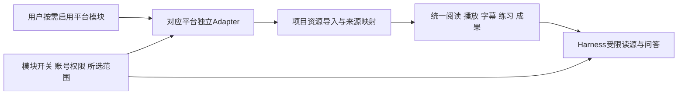

# 八平台模块化与并行开发拆分草案

2026-10-24后续收口：本草案保留为讨论历史。用户已全部接受[共用准备需求](../product/平台接入共用准备需求收口-2026-10-24.md)及[正式并行交接方案](八平台模块化并行开发交接方案-2026-10-24.md)，已同步8份原需求。下文“建议／待确认”、旧菜单定位及串行安排不再代表最新决定；默认关闭／按需加载、启停、原生“＋”／指令和对话入口、共用分工及平台并行／单独验收以两份正式文档为准。本次仍仅文档、不开发。

日期：2026-10-23（Asia/Shanghai）。用户要求整理已写的8份接入需求，准备分开并行开发；进一步明确平台接入必须模块化、用户按需选择，不能默认全部加入Harness，并要求讨论可复用与独立开发的范围。

**本轮只整理设计与交接草案，不启动接入开发。** “8个平台独立、按需启用、默认不全部加入Harness”是用户明确约束；下文具体共用Interface、目录、启停行为和并行分工是待确认建议，不冒充已实现契约。8份原需求仍是平台功能与排除项的主要来源，工作包状态仍只在[MVP开发计划](MVP开发计划.md)维护，不在本文另记完成状态。

## 1. 先区分三种复用

1. **现有学习能力直接沿用或作窄适配**：播放器、阅读器、OCR／ASR、来源快照、进度、问答、学习成果与任务恢复，不为每个平台重做。
2. **新增接入共用能力只建设一份**：平台模块开关、按需加载、平台账号私有存储与连接状态、导入编排、远程来源映射、后台检查协调、模型能力授权。
3. **第三方协议和业务差异分别实现**：每个平台自己的登录、Cookie／token、课程／资源解析、字幕取得、权限与副作用、写入和结果核对。

这不是已有一个完整通用平台连接器。当前8平台只有需求与研究证据；已有学习实现也不代表当前13场景已统一验收，实际状态继续核对MVP计划。

## 2. 用户能选模块，Harness不默认挂8套工具

- **建议8个平台默认关闭**。设置可列出可选模块名称和说明，不代表初始化其SDK、启动进程、登录或注册模型工具。
- 多数学习流程由本项目后台取得资料，导入后Harness使用项目统一的受限读源能力，不需要各平台分别常驻一整套MCP。
- 确需查询原平台的场景，如明确要求搜索未导入的Zotero文献，才按已启用模块、实际账号权限和本次允许范围提供窄能力。不提供任意URL／任意平台方法的通用透传工具。
- 只有启用B站时，不加载其余7个平台的模型工具定义、skill说明、凭据或后台检查任务。启用平台也不等于把全部课程和历史记录发送模型。
- 沿用Harness原生skill发现与调用，不增加应用层每轮全平台扫描或自动检索；即使复用同一项目读源工具，也须在执行时检查实际来源和权限。
- 墨墨收词和Zotero导出仍由用户确认具体内容与目标后执行。模块启用和账号登录不能替代外部写入确认，凭据不交给模型。
- 建议停用后阻止新的平台访问和背景检查，撤销后续工具能力；已保存本地资料、历史和成果仍可用统一阅读能力使用。已发出请求记录回执，未知结果不盲目重发；停用与恢复对账的精确时序待实现契约收口。
- 代码可随应用内置并按需加载，不必强制做8个独立可执行程序，也不先建设在线插件市场。重型依赖和外部进程按实际需要独立加载，不能因未启用模块缺依赖而阻塞本地学习启动。

## 3. 已有实现可复用，但适用范围要核实

| 可复用内容 | 当前代码入口示例 | 平台包应做的事 |
| --- | --- | --- |
| 课程文件管理、复制／改名／移动 | [course_files.py](../../backend/src/learning_app/course_files.py)、[FileManager.tsx](../../frontend/src/library/FileManager.tsx) | 将远程条目与所选本地副本接入既有身份；远程条目不是已支持的任意本地路径 |
| 视频播放、截图、播放位置 | [media.py](../../backend/src/learning_app/media.py)、[VideoWorkspace.tsx](../../frontend/src/media/VideoWorkspace.tsx) | 提供获准且有效的媒体来源；鉴权流、过期链接、编码／SDK兼容不能由播放器复用自动解决 |
| PDF／文字阅读、OCR及准备队列 | [reading.py](../../backend/src/learning_app/workbench/reading.py)、[preparations.py](../../backend/src/learning_app/workbench/preparations.py) | 取得实际文件或有来源的派生内容，并报告格式、页数及缺口 |
| 字幕存储、ASR和用户修订 | [transcripts.py](../../backend/src/learning_app/workbench/transcripts.py)、[preparations.py](../../backend/src/learning_app/workbench/preparations.py) | 取得平台字幕或获准音频，区分同步字幕／纯文本及原始／派生身份 |
| 来源版本、精确引用和材料范围 | [sources.py](../../backend/src/learning_app/workbench/sources.py) | 提供平台、账号／库、课程／期次和资源身份，接入不可变引用，不把新版本指给旧问答 |
| 持久任务、恢复和操作对账 | [tasks.py](../../backend/src/learning_app/workbench/tasks.py)及既有存储 | 复用任务规则；新增下载、远端检查或外部写入仍需各自操作语义和检查点 |
| 模型执行、来源handle及工具guard | [native_business.py](../../backend/src/learning_app/workbench/native_business.py)、[learning-guard.mjs](../../harness/plugins/learning-guard.mjs) | 延续范围、owner和执行授权；平台模块开关及按需暴露仍是新增工作，不能直接宣称已支持 |
| 练习、错题、复习、成果与AI翻译 | [13场景需求](../product/13场景学习工作台需求收口-2026-10-23.md)与MVP对应实现 | 沿用已有或正在建设的能力，不各平台重做；未完成部分继续按原计划交付，不冒充可直接验收 |

上述是复用位置及限制，不是对代码已通过全部场景的二次验收。正式桌面同时有[库导出入口](../../desktop/src/library-entry.tsx)与业务桥，不能只改旧网页就认定已接入Harness桌面。

## 4. 接入时需要共建的一份能力

| 共用Module | Interface应隐藏的复杂性 | 仍留给平台实现的差异 |
| --- | --- | --- |
| 模块管理 | 启用、停用、能力声明、加载失败与隔离 | 平台可提供哪些实际能力及其依赖 |
| 连接与私有凭据管理 | 私有保存、账号区分、过期状态与解绑 | 登录页面、扫码、OAuth／OIDC、本地授权、Cookie刷新和身份绑定 |
| 浏览选择与导入编排 | 分页／选择UI、导入计划、重复操作防护、结果与缺口 | 收藏夹、课程／班级／期次、文献集合、词本等真实对象及解析 |
| 下载与文件接入 | 字节传输、完整性、检查点、原件与副本关联 | 获准地址、CDN跳转凭据约束、分片／加密／播放SDK及有效期 |
| 来源身份与版本映射 | 平台身份接入项目asset／source_version，保护历史引用 | 远端ID、变更依据与版本含义，不把不同平台版本号互比 |
| 检查与变更提醒 | 持久任务、调度、前台优先、提醒及手动更新 | 哪些对象可查、检查会不会写状态、频控及原需求允许范围 |
| 确认与操作回执 | 对所选目标／内容确认、持久回执、部分成功及未知先对账 | 墨墨词本／学习计划语义、Zotero对象创建与版本冲突等 |
| 本项目语言学习能力 | AI查词翻译、候选筛选及本地词汇画像，沿用主回答模型与项目成果存储 | 墨墨词ID、实际可读词本／学习记录及加词写入；画像等新增功能不冒充已经实现 |
| Harness按需能力装配 | 在请求及执行阶段同时落实启用与权限，不暴露停用模块 | 模块必要的窄读取操作；不能注册全部第三方原始工具 |

共用Interface按业务意图设计，不先做任意第三方插件总线，也不把所有平台塞进大量可空方法的万能接口。建议按“学习资料来源”“词汇同步”“文献及导出”等能力拆出小Interface；正式网络字段仍从Pydantic与生成契约产生，本文不另写一套DTO真相源。

## 5. 8个平台仍分别作为独立Module交接

| 建议module_id | 独立需求主要来源 | 该平台独立Implementation负责 |
| --- | --- | --- |
| `bilibili` | [Bilibili](../product/Bilibili平台接入需求收口-2026-10-23.md) | 登录、收藏夹手选、视频／多P／合集、媒体和字幕获取、会员／充电／已购权限、试看识别；多P标题文件夹与顺序 |
| `chaoxing` | [学习通](../product/学习通平台接入需求收口-2026-10-23.md) | 课程／班级、资料区与章节资源、作业／测验／已批阅考试和可见反馈；课表、通知、云盘；只读与任务点界限 |
| `maimemo` | [墨墨背单词](../product/墨墨背单词接入需求收口-2026-10-23.md) | 墨墨授权、词ID匹配、云词本和个人学习状态、相关去重、确认加词及学习规划、可选例句；不另建正式复习调度 |
| `zotero` | [Zotero](../product/Zotero接入需求收口-2026-10-23.md) | 本机与云端、个人／群组库、题录和多附件、笔记批注、引用交换、指定范围查询、新文献收录及主动导出 |
| `icourse163` | [中国大学MOOC](../product/中国大学MOOC接入需求收口-2026-10-23.md) | 我的课程／链接、课程期次与SPOC／已购权限、视频SDK／媒体／字幕、课件附件及题目反馈；执行其明确排除项 |
| `yuketang` | [雨课堂](../product/雨课堂接入需求收口-2026-10-23.md) | 服务器／学校身份、课程班级课次、课后课件页图与回放音视频、题目及答案身份；排除隐含签到和实时课堂 |
| `xuetangx` | [学堂在线](../product/学堂在线接入需求收口-2026-10-23.md) | 公共课与学校学堂云／SPOC分入口、课程期次、媒体字幕／资料和题目反馈；包含GET写状态在内的只读规则 |
| `zhihuishu` | [智慧树／知到](../product/智慧树知到接入需求收口-2026-10-23.md) | 共享学分／公开／翻转／AI Pro的身份与协议、章节／知识点、见面课回放、资料题目；避免附带学习上报、外部ASR和素材删除 |

这些ID是建议的项目内部标识，不是供应商真实ID；此表只做交接索引，未复述的范围仍按各原需求全文，不得用摘要缩减交付。

## 6. 同源平台可以复用代码，不合并模块

- 雨课堂、学堂在线／学校学堂云若实测存在相同会话或资源协议，可抽取经过验证的内部Adapter辅助实现；各自的启用状态、账号、课程范围、权限和验收继续独立。不因复用代码就自动启用另一模块。
- 同一供应商的普通学生接口、学校租户与教师端也不能默认共用权限；参数相似或域名替换不是兼容证据。
- 墨墨、Zotero都可能使用授权登录，但授权机制和远端对象不同。可复用凭据存储、确认UI和回执规则，不能共用业务写入逻辑。
- AI查词翻译、筛词和词汇画像属于本项目语言学习能力，墨墨提供相关远端学习证据和收词通路。关闭墨墨不能连带关闭普通英语阅读／翻译；未启用时画像也不得继续拉取墨墨记录。
- B站收藏夹和课程章节可以复用选择树交互，不能共用目录解析器；Zotero题录与多个附件保持文献关系，不压平成同一种普通文件；墨墨也不伪装成视频课程来源。
- 学习通有已确认课表、通知与云盘；其他平台的排除项不同，不能为了共用导入器就把这些能力全部取消或全部打开。

## 7. 并行开发的文件责任建议

| 责任 | 建议独占范围 | 合并规则 |
| --- | --- | --- |
| 共用接入与集成负责人 | 模块开关／注册、共用Interface、统一资源映射、应用入口、共享DTO／路由、数据库迁移、锁文件、Harness profile／guard、共享桌面入口及MVP状态 | 先冻结最小可用Interface；统一生成schema、分配迁移并集成，避免8方同时改公共文件 |
| 8个平台负责人 | 各自平台的Adapter、必要设置／选择视图、fixture、契约及平台测试、研究／验收报告 | 只改本平台目录；共用能力缺口提交明确接口需求，不复制一份播放器／存储／调度器或擅自改公共入口 |

拟用目录可为`backend/src/learning_app/integrations/<module_id>/`、`frontend/src/integrations/<module_id>/`及对应平台测试／fixture／报告目录；它们是草案路径，本轮未创建源码骨架。共用能力由一位负责人维护，平台必要的UI扩展仍保留在本模块，不强求8种业务使用完全相同页面。

并行可先做平台协议和确定性fixture；接入共享Interface后完成实际导入／学习闭环。不能把Adapter或下载脚本通过当作平台全部通过。各平台独立验收，启用某一个不得依赖其他7个已启用。

## 8. 工作区、集成与验收

- 当前工作区有大量已修改和未跟踪正式文件，另有13场景工作进行中。不能让8个聊天在同一工作区同时写公共文件，也不能直接从旧HEAD开worktree并假定包含当前学习工作台。
- 建议由集成负责人核定一个包含必要源码、锁文件与正式文件的基线，再从同一基线建独立分支／worktree；不自动批量提交工作区或复制`.local`、`.runtime`、凭据和私人数据。本轮没有创建分支、worktree或提交。
- 每个工作区使用隔离的运行数据、端口和所属进程；模型home、数据库、浏览器profile及平台凭据不在多个运行实例间共写，迁移编号与生成契约由集成负责人协调。
- 8个平台可并行开发，与原需求中早前串行安排的差异将在正式交接收口时统一说明；平台分别验收仍有效。可用B站作为首个共用Interface接入样例，其他平台不必等待其完成才研究协议或开发fixture。
- 验证包括：全关闭时没有平台工具／skill或后台访问且本地学习可用；只启用一个时不加载其余平台；账号／课程范围隔离；停用后旧上下文不能调用能力；部分成功和未知写入不重发；模块故障不拖垮本地学习。
- 确定性fixture、真实平台／账号、真实模型和实际学习体验分别报告，受阻能力保持未通过。当前已有实现和历史通过记录不能替代8个平台各自验收。

## 9. 后续收口时需要确认的设计

建议采用“全局按平台启用＋当前课程／明确任务范围装配能力”，避免每次阅读重复勾选，同时不把所有已启用模块都塞进每一轮Harness。停用后保留本地学习、停止新平台访问，外部写操作仍逐批确认。是否采用此具体行为与共用分工，待用户确认后再同步8份原需求、应用契约和正式执行交接；本草案不自行扩大本轮开发授权。
